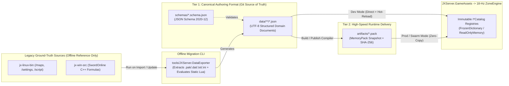
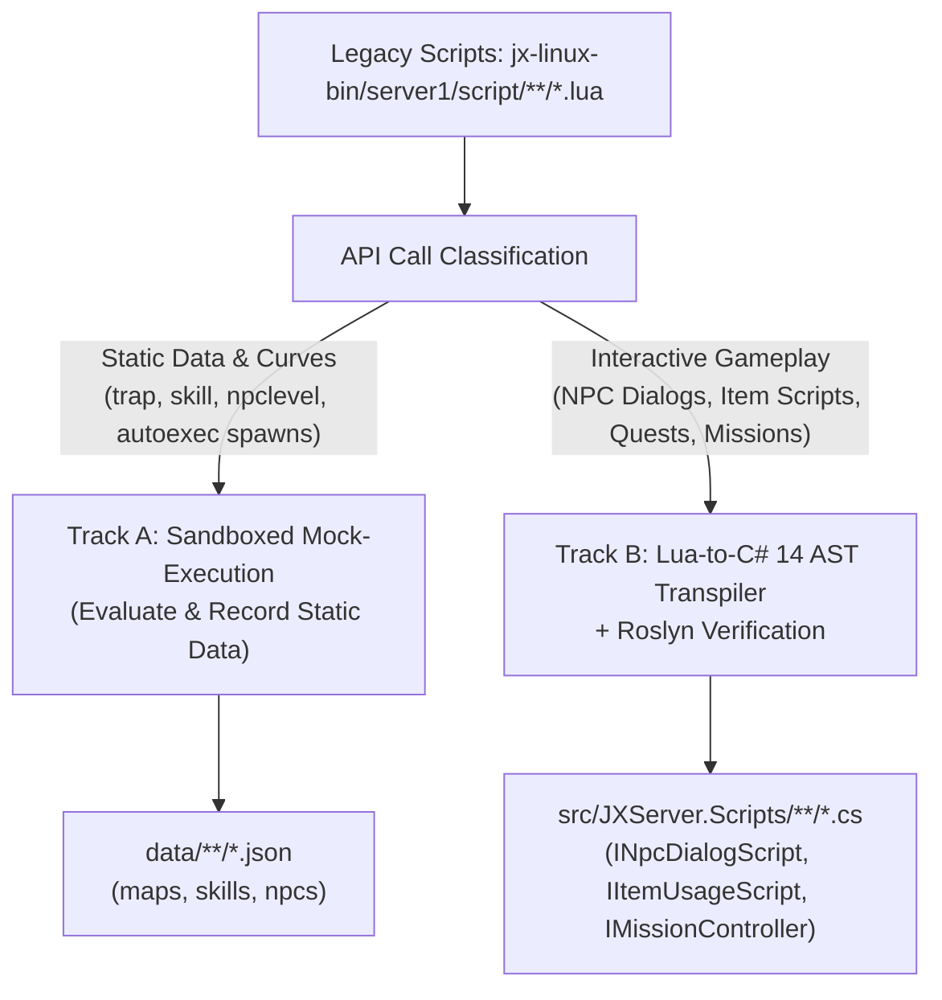

# JXServer Data Architecture Standard (`JXData Standard v1`)

**Status**: Approved Architecture Standard (Aligned with Constitution `v1.2.0`)  
**Applies To**: `JXServer.GameAssets`, `JXServer.Domain`, `JXServer.Scripts`, `tools/JXServer.DataExporter`, `data/`, `schemas/`, and all Feature Specifications (`001`–`005+`)

---

## 1. Executive Summary & Architectural Goals

Original Võ Lâm Truyền Kỳ (JX1 / JXLinux 6.0) server assets are fragmented across thousands of legacy files:
- 105-column tab-delimited `.txt` files (`KTabFile` where Row 1 is headers, Row 2 is baseline defaults, and Row 3+ are records) encoded in legacy single-byte `TCVN3` or `GBK`.
- Untyped `.ini` configuration files (`worldset.ini`, `maplist.ini`, `series.ini`, `revivepos.ini`, `droprate/*.ini`).
- Thousands of per-region binary `Region_S.dat` files inside `/maps` (`OBSTACLE_SECTION`, `TRAP_SECTION`, `NPC_SECTION`, `OBJ_SECTION`).
- Imperative Lua 4.0 scripts (`script/**/trap/*.lua`, `script/skill/**/*.lua`, `script/npclevelscript/*.lua`, `script/global/autoexec.lua`) that hardcode static portal destinations, NPC spawn coordinates, monster level scaling formulas, and per-level skill scaling curves.

To modernize the server without losing a single bit of mechanical fidelity, **JXServer** adopts a **Dual-Tier Game Data Architecture (`JXData Standard v1`)** fed by a **Standalone Offline Ground-Truth Exporter**:



1. **Tier 1 — Authoring & Git Source of Truth (`data/**/*.json` + `schemas/*.schema.json`)**:
   - 100% standard **UTF-8 JSON** validated by **JSON Schema (Draft 2020-12)**.
   - Organized by **Business Domain** (`maps/`, `npcs/`, `players/`, `skills/`, `items/`, `loot/`, `shops/`) rather than legacy file extensions.
   - Replaces flat `Param1..ParamN` columns and hardcoded Lua data with hierarchical, self-documenting, schema-validated structures.
2. **Tier 2 — Zero-Copy Runtime Delivery Snapshot (`MemoryPack`)**:
   - Pre-compiled binary snapshots (`*.pack`) with `SHA-256` integrity checksums generated from the canonical JSON files for zero-allocation, sub-millisecond startup in high-concurrency production and swarm environments.
   - During local development and automated testing, `JXServer.GameAssets` loads directly from `data/**/*.json` (with hot-reload support).

---

## 2. Repository Directory Layout for Game Data

All canonical game data and schemas reside at the repository root under `schemas/` and `data/`:

```text
jx-server/
├── schemas/                              # JSON Schema (Draft 2020-12) contracts
│   ├── map.schema.json                   # Unified spatial map, maplist rules, obstacles, portals, spawns & map objects
│   ├── npc-catalog.schema.json           # NPC & monster archetypes, 4-slot skills, AI params, boss elemental damage & partners
│   ├── player-template.schema.json       # Five-elements matrix, base stats, level growth, factions, starter villages, meridians & guilds
│   ├── skill-catalog.schema.json         # Skills, child/event skill trees, proc triggers, 3-param curves & 64-dir missiles
│   ├── item-catalog.schema.json          # White/Blue/Gold/Purple/Platina/Script items, per-part/series affix weights, sets & crafting
│   ├── loot-table.schema.json            # Weighted monster drop-rate trees & level-scaled equipment pools
│   └── shop-catalog.schema.json          # Multi-currency NPC shop merchandise catalogs (buysell.txt & goods.txt)
└── data/                                 # Canonical UTF-8 JSON Game Data (Source of Truth)
    ├── maps/
    │   └── 053_ba-lang-huyen.map.json
    ├── npcs/
    │   ├── core.npcs.json
    │   ├── global-spawns.npcs.json
    │   └── event-spawns.npcs.json
    ├── players/
    │   └── progression.players.json
    ├── skills/
    │   ├── base-and-factions.skills.json
    │   └── missiles.skills.json
    ├── items/
    │   ├── equipment.items.json
    │   ├── golden-equipment.items.json
    │   ├── consumables-and-scripts.items.json
    │   └── magic-affixes.items.json
    ├── loot/
    │   └── field-monsters.loot.json
    └── shops/
        └── npc-shops.shops.json
```

---

## 3. Core Standardization Rules (Mandatory for All Contributors)

### Rule 1: Zero Synthetic IDs & Symmetric Semantic `code` Convention
1. **Zero Synthetic IDs (100% Engine-Faithful Keys)**:
   - **`id`** (`integer`) is ONLY emitted when the C++ Engine / wire protocol (`s2c_*` / `c2s_*`) natively identifies the entity by a single integer ID:
     - **Map**: `id` (`1..999` `SubWorld` ID), **NPC**: `id` (`0`-based `0..2539` `TemplateId` in `npcs.txt`), **Skill**: `id` (`SkillId`), **Missile**: `id` (`MissleId`), **Shop**: `id` (`1`-based `Sale(shopId)` row in `buysell.txt`), **GroundObject**: `id` (`DataID` in `objdata.txt`), **Player / Faction / Meridian / Tong**: exact C++ ID.
   - **Item & MagicAffix** NEVER invent synthetic `100,000+` / `200,000+` IDs: they emit exact `1`-based **`rowId`** of their source `.txt` table (`GoldId` `1..7148` in `goldequip.txt`, `PlatinaId` `1..8783` in `platinaequip.txt`, `rowId` `1..6320` in `magicattrib_ge.txt`) paired with their natural composite key `(quality, genre, detailType, particularType, level)` or `affixPool`.
   - **LootTable** (`droprate/**/*.ini`) is identified purely by **`code`** (no artificial integer `id`).
2. **Semantic, Symmetric `code` (`kebab-case` ASCII, Zero Redundant Prefixes)**:
   - Never emit redundant prefixes such as `map-53-ba-lang-huyen` or `npc-0-dong-bac-ho`. Map files are named `<id:D3>_<code-slug>.map.json` (e.g., `053_ba-lang-huyen.map.json`).
   - **ID-Based Domains (`Map`, `NPC`, `Skill`, `Missile`, `Shop`, `Object`)**:
     - Unique display name within its catalog $\rightarrow$ pure `<slug>` (e.g., `ba-lang-huyen`, `dong-bac-ho`, `vo-dang-kiem-phap`).
     - Duplicate display name ($\ge 2$ records in the same catalog) $\rightarrow$ **ALL** colliding members append `-<id>` symmetrically (e.g., `tieu-dao-tu-2533` & `tieu-dao-tu-2537`, `thieu-lam-de-tu-phong-107` & `thieu-lam-de-tu-phong-108`) so no caller ever binds to an ambiguous shared name.
   - **Item, MagicAffix & LootTable Domains**:
     - **Items**: Globally unique display name $\rightarrow$ pure `<slug>` (e.g., `tho-dia-phu`, `vo-lam-mat-tich`, `thanh-phong-kiem`). When colliding, disambiguate semantically by `-lv<level>` and `-<series>` (`kim`/`moc`/`thuy`/`hoa`/`tho`) first, then by table row (`-hk<rowId>` for Golden, `-bk<rowId>` for Platina, `-r<rowId>` for others, e.g., `bon-tieu-lv1`..`bon-tieu-lv10`, `mong-long-chinh-hong-tang-mao-hk1`).
     - **MagicAffixes**: `<pool>-<slug>-r<rowId>` (`blue-`, `purple-`, `gold-`).
     - **LootTables**: Derived from relative path under `settings/droprate/` (e.g., `npcdroprate10`, `goldennpc-golden-lv40`).
   - **CJK Transliteration**: Untranslated Chinese names (`2017VIP·雪域战狼`, `放爆竹特效`) are transliterated to ASCII Pinyin/Hán-Việt when generating `code` so slugs never lose meaning.

### Rule 2: Unit-Explicit Coordinate & Timing Property Names
To prevent unit conversion bugs across the 18-Hz simulation loop, every spatial coordinate and duration field in JSON MUST include its explicit unit suffix, matching the C# naming conventions in [`.specify/memory/constitution.md`](../.specify/memory/constitution.md):
- **World Pixels**: `*MpsX`, `*MpsY`, `*RadiusMps`, `*SpeedMpsPerFrame` (`1 Cell = 32x32 Mps`, `1 Region = 512x1024 Mps`).
- **Obstacle/Trap Cells (`32x32` Mps)**: `*CellX`, `*CellY`, `*WidthCells`, `*HeightCells`, `*RadiusCells`.
- **Spatial Regions (`16x32` Cells = `512x1024` Mps)**: `*RegionX`, `*RegionY`, `*LeftRegionX`, `*TopRegionY`, `*RightRegionX`, `*BottomRegionY`.
- **Time Durations**: `*Frames` (for 18-Hz simulation ticks where `18 Frames = 1 Second`) or `*Seconds` / `*Minutes` / `*Ms`.

### Rule 3: Declarative Data Over Imperative Lua (Dual Curve + Pre-Evaluated Table)
Static game data MUST NEVER be hidden inside imperative script files:
- **Map Portals & Town Gates (`TRAP_SECTION` + `script/**/trap/*.lua`)**: 100% of `trapId` (`uint32`) entries present in `Region_S.dat` are preserved in the `portals` array of `*.map.json`:
  - Static portals & bidirectional town gates use `"teleport"`, `"toggleFightMode"`, or `"randomTeleport"`.
  - Mission/battlefield traps use `"customScript"` with `scriptCode` / `scriptPath`.
  - Orphan `trapId` hashes in `Region_S.dat` without a corresponding `.lua` file on disk are preserved with `"action": "unmapped"` and their `triggerCells` intact so zero spatial data from `Region_S.dat` is ever lost.
- **Skill Level Scaling (`Level 1..64`)**: Each parameter curve (`param0`, `param1`, `param2`) stores **both**:
  1. The declarative control points (`curve`: `"constant"`, `"linear"`, `"piecewise"`, `"conic"`, `"sqrt"` + `points`) matching the `SKILLS` table in `script/skill/**/*.lua` for human readability and authoring.
  2. The pre-evaluated `valuesByLevel` integer array (`[lv1..lvMax]`) computed via exact IEEE 754 `double` + `Math.Floor` (`Link`/`Conic`/`Extrac`/`Line`) so the `18-Hz` `ZoneEngine` performs $O(1)$ array lookup with zero integer-division rounding drift across fractional `19`-step (`level 1..20`) intervals.
- **Monster Level Scaling & Spawns**: Monster stat growth formulas (`npclevelscript/*.lua`) are declared inside `combatScaling` on NPC templates, while map-level elemental/level overrides (`maplist.ini`) and `spawnGroups` live inside `*.map.json`.

### Rule 4: Literal UTF-8 Formatting, Domain-Grouped Files, Referential Integrity & 4-Layer Parity Verification
- Every `.json` file under `data/` MUST declare `"$schema"` and `"schemaVersion": "1.0.0"` at the root object and serialize with **unescaped literal UTF-8 Vietnamese/CJK text** (`JavaScriptEncoder.UnsafeRelaxedJsonEscaping`, e.g., `"Ba Lăng huyện"`, `"Thanh Phong Kiếm"` — never `\uXXXX` escape sequences).
- Large catalogs (`data/items/`, `data/skills/`, `data/npcs/`) are split into logical category files, validated via `anyOf` at the schema root.
- **100% Foreign-Key Referential Integrity**: Every `*Code` cross-reference (`npcCode`, `itemCode`, `skillCode`, `lootTableCode`) in Maps, Shops, Players, and LootTables MUST resolve to an existing canonical `code` in its target catalog.
- **4-Layer Ground-Truth Parity Verifier (`artifacts/migration-parity-report.json`)**: Verifies (1) 100% file inventory coverage (`Unaccounted == 0`), (2) 1:1 physical row & record counts across all domains, (3) bitwise/cell-by-cell round-trip reconstruction (`obstacleRleBase64`, `triggerCells`, `fixedMagicAffixes`, `valuesByLevel`), and (4) 100% JSON Schema + Referential Integrity validation across all 7 domains.

### Rule 5: Physical `KTabFile` Line Indexing (`lineIdx`), Row-2 Baseline Default Inheritance & Empty-Name Rows
- In Kingsoft's C++ `KTabFile`, Row 1 (`lineIdx = 0`) is the column header row, and **Row 2 (`lineIdx = 1`) is both the first data record AND the baseline default template row**: whenever a cell in Row 3+ (`lineIdx >= 2`) is empty (`""`) for a template attribute (e.g., in `npcs.txt`, `skills.txt`, `missles.txt`), the exporter inherits the default value from Row 2 (except for optional list slots such as `Skill1..4`, `MagicAttrib1..6`, or `Goods1..116`).
- Physical line indices MUST NEVER be shifted by skipping blank or tab-only rows (`StringSplitOptions.RemoveEmptyEntries` is forbidden on index-sensitive tables):
  - `npcs.txt` uses exact `0`-based `id = lineIdx - 1` (`0..2539`); for rows with an empty `Name` column (such as `lineIdx = 2535` / `id = 2534` `enemy046`, or `magicscript.txt` rows `1232..1237` where `Name` is a space and the item name is in the description column), a deterministic fallback name/slug (`npc-2534`, or derived from description) is generated so subsequent IDs (`2535` *Hoàng Bảo Câu*, `2536` *Bậc Thầy Dị Dung*, `2537` *Tiêu Dao Tử*) never shift.
  - `buysell.txt` (`shopId = lineIdx`), `goods.txt` (`goodsId = lineIdx`), `goldequip.txt` (`rowId = lineIdx`), `platinaequip.txt` (`rowId = lineIdx`), and `magicattrib_ge.txt` (`rowId = lineIdx`) preserve their exact `1`-based physical row index, skipping tab-only rows (`buysell.txt` lines `173..174`) without decrementing the `shopId` of subsequent rows (`175..179`).

### Rule 6: Per-Cell Hybrid `TCVN3` / `GBK` (CP936) Decoding & Raw Path Resolution
- Legacy `jx-linux-bin` files mix `GBK` (CP936) and `TCVN3` within the same file:
  - Column headers (`名称`, `魔法属性索引1`), `.lua` / `.spr` / `.ini` file paths (`\script\skill\special\长兵物理攻击.lua`), and ~15% of newer items/skills (`2017VIP·雪域战狼`, `放爆竹特效`, `magicattrib_ge.txt`) are encoded in **GBK (CP936)**.
  - Vietnamese display names and descriptions are encoded in **TCVN3**.
- The exporter decodes headers and file paths using raw bytes / `GBK` (CP936) so disk lookups match 100%, and applies per-cell heuristic detection on text columns (decoding as `TCVN3` by default, and falling back to `GBK` + Hanzi-to-Pinyin/Hán-Việt slugging when valid CJK byte sequences are detected).

### Rule 7: Canonical `KBasPropTbl` Item Lookup (`rowId` + Natural Composite Key) & Stack Overrides
- Every item in `data/items/*.items.json` preserves its exact `1`-based **`rowId`** within its source `.txt` table (`GoldEquipId` `1..7148` in `goldequip.txt`, `PlatinaId` `1..8783` in `platinaequip.txt`, `magicscript_stack.txt`, and `questkey_stack.txt`) alongside its natural composite key `(quality, genre, detailType, particularType, level)` — with zero synthetic `id` numbers.
- `IItemTemplateCatalog` supports $O(1)$ lookup by `code`, `(quality, rowId)`, and `(quality, genre, detailType, particularType, level)`.
- Only the canonical C++ `KBasPropTbl` files are loaded from `settings/item/004/` (ignoring admin backup copies such as `goldequip1.txt`, `goldequip_.txt`, `magicscript2.txt`, `questkey_.txt`, `horse--.txt`, `*_2006.txt`), and stack overrides from `magicscript_stack.txt` (`0`-based) and `questkey_stack.txt` (`1`-based) are merged directly into each item's `maxStackCount` and `stackingRules`.

### Rule 8: Over-Cap Skill Curve Evaluation (`+AllSkill`) & Procedural Lua Execution + `autoexec.lua` Map Spawns
- **Over-Cap Skill Levels & Procedural Lua (`script/skill/**/*.lua`)**:
  - Pre-evaluated `valuesByLevel` arrays are computed up to `Math.Min(64, Math.Max(maxLevel + 15, Math.Max(maxControlPointLevel, 30)))` so `+AllSkill` (`allskill_v` / *Kỹ năng vốn có +N*) equipment works natively in $O(1)$ array lookup beyond `MaxLevel = 20`.
  - The exporter evaluates both declarative `SKILLS` / `SKILLS_4P` tables (including `FileName2Id(...)` expressions) and procedural `GetSkillLevelData(levelname, data, level)` functions across all `316` skill Lua scripts.
- **3-Tier NPC & Trap Placement Architecture (`Region_S.dat` vs `global-spawns.npcs.json` vs `event-spawns.npcs.json`)**:
  1. **Map-Specific Fixed Spawns (`data/maps/<id:D3>_<code-slug>.map.json`)**: Contains ONLY the native spatial placements baked into that map's binary `Region_S.dat` (`NPC_SECTION`, `TRAP_SECTION`, `OBJ_SECTION`).
  2. **Global Cross-Map Functional Spawns (`data/npcs/global-spawns.npcs.json`)**: Contains permanent system NPCs and traps placed across multiple cities/villages in `script/global/autoexec.lua` (e.g., *Nhiếp Thí Trần* across 7 cities, *Người hướng dẫn bang hội* across 8 starter villages, *Dịch Quan*, *Phạt Ác Sứ*, *Tiêu Dao Tử*, *Thợ Rèn Huyền Tinh*, *Hắc Sa Động Trap*) with `"spawnCategory": "globalPermanent"` and `"enabledByDefault": true`.
  3. **Event & Feature-Gated Spawns (`data/npcs/event-spawns.npcs.json`)**: Contains conditional feature and seasonal event NPCs/traps from `autoexec.lua` and event scripts (e.g., *Tiếp Đầu Công Thành Chiến*, *Bình Bình Cô Nương - Viêm Đế*, *Long Ngũ*, *Ông Già Noel*, *Hằng Nga*, *Sự kiện Tháng 1..12*) tagged with `"spawnCategory": "eventOrFeature"` and `"featureFlag": "CFG_..."` so server operators can toggle features/events centrally without touching map files.

---

## 4. Domain Specifications (`JXData Standard v1`)

### 4.1. Unified Map Document (`data/maps/<id>_<code-slug>.map.json` — [map.schema.json](../schemas/map.schema.json))
Consolidates `.wor`, `maplist.ini`, `forbitheart.txt`, `settings/battles/maps/*`, all `v_YYY/XXX_Region_S.dat` sections (`0..3`), `trap/*.lua` bindings, and `autoexec.lua` map spawns into a single file per map:
- **`id`**, **`code`**, **`name`** (UTF-8 Vietnamese display name), **`mapType`** (`"City"`, `"Capital"`, `"Field"`, `"Cave"`, `"Battle"`, `"Mission"`, `"Prison"`), **`worldMapPos`**.
- **`mapRules`** (from `settings/maplist.ini` and `settings/forbitheart.txt`):
  - `allowPk`, `allowTownPortal`, `allowRecall`, `forbidHeartTeleport`, `forbiddenSkillIds`, `forbiddenItemCodes`.
  - `normalLootTableCode` and `goldenLootTableCode` (map-wide monster drop table overrides).
  - `autoGoldenNpcRate` and `goldenType` (automatic promotion of normal spawns into Blue/Golden Bosses).
  - `npcAutoLevel` (`{ "enabled", "minLevel", "maxLevel" }`) and `npcAutoSeries` (`{ "enabled", "metalWeight", "woodWeight", "waterWeight", "fireWeight", "earthWeight" }`) for dynamic monster level/series assignment on spawn.
- **`regionBounds`**: `{ "leftRegionX", "topRegionY", "rightRegionX", "bottomRegionY" }`.
- **`regions`**: Sparse array of non-empty regions `{ "regionX", "regionY", "obstacleRleBase64" }`, where `obstacleRleBase64` encodes the `16 x 32 = 512` `int32` barrier matrix in `(cellX * 32 + cellY)` order (`ObstacleKind` in bits `0..3` + `4x4` `SubCellMask` in bits `4..19`) as a sequence of **6-byte Little-Endian RLE pairs (`UInt16 runLength` in `1..512` + `Int32 cellValue`)** encoded in Base64. Regions where all 512 cells equal `0` (`Obstacle_NULL`) are omitted from `regions`.
- **`portals`**: Declarative trap definitions replacing `TRAP_SECTION` + `script/**/trap/*.lua`:
  - `trapId`, `code`, `scriptCode`, `scriptPath`, `action` (`"toggleFightMode"` | `"teleport"` | `"randomTeleport"` | `"customScript"` | `"unmapped"`), primary destination (`targetMapId`, `targetMpsX`, `targetMpsY`, `targetFightMode`), bidirectional town-gate return destination (`alternateMpsX`, `alternateMpsY`, `alternateFightMode`), `randomTargets` array, `dismountHorse`, `minLevel`, `maxPkValue`, `requiredCamp`, `requiredFactionId`, `bounceMpsX`, `bounceMpsY`, `deniedMessage`, and `triggerCells`.
- **`spawnGroups`**: Grouped NPC/monster placements replacing `NPC_SECTION` + `autoexec.lua`:
  - `npcTemplateId` (`0`-based), `npcCode`, `nameOverride`, `entityKind`, `level`, `series` (`-1` for map auto-series or `0..4`), `camp`, `fightMode`, `isSpecialNpc` (Blue/Gold Boss flag), `goldenType`, `respawnFrames`, `aiProfile`, `scriptCode` (binding to `[NpcScript("...")]` in `JXServer.Scripts`), `scriptPath`, `lootTableCode`, and `spawns` (`[{ "mpsX", "mpsY", "dirIndex", ... }]`).
- **`mapObjects`** & **`namedPointGroups`**: Static interactive objects replacing `OBJ_SECTION` (`Region_S.dat` Section 3, e.g., chests, signposts, switches/doors) and named coordinate groups for battlegrounds/missions (`settings/battles/maps/*`).

### 4.2. Skill & Missile Catalog (`data/skills/*.skills.json` — [skill-catalog.schema.json](../schemas/skill-catalog.schema.json))
Consolidates `settings/skills.txt`, `settings/missles.txt`, `settings/clientweaponskill.txt`, `settings/attribconstdata.ini`, `SkillDef.h`, and `script/skill/**/*.lua`:
- **`skills`**:
  - `id`, `code`, `name`, `style` (`"melee"`, `"projectile"`, `"selfBuff"`, `"targetBuff"`, `"aura"`, `"passive"`, `"summonNpc"`, `"jump"`, `"jumpAndAttack"`, `"runAndAttack"`, `"multiAttack"`, `"corpseExplode"`, `"strideObstacle"`, `"steal"`), `elementSeries` (`-1`..`4`), `isOffensive`, `isPhysical`, `isMelee`, `isAura`, `isWeaponSkill`, `isExpSkill` (proficiency-leveled 90x/120x/150x skills), `useAttackRating`, `doHurtAnimation`, `peaceCanUse`.
  - **Restrictions & Timing**: `lrSkillInfo` (`"both"`, `"leftOnly"`, `"rightOnly"`, `"none"`), `reqLevel`, `maxLevel` (`1..64`), `equipLimit` (`EqtLimit` weapon restriction), `horseLimit` (`0`=any, `1`=horse only, `2`=foot only), `castRangeMps`, `waitFrames` (cooldown), `minFramesPerCast`, `minFramesPerCastOnHorse`.
  - **Multi-Stage, Child/Event Skill Trees & Proc Triggers**:
    - `missileId`, `missileForm` (`"wall"`, `"line"`, `"spread"`, `"circle"`, `"random"`, `"zone"`, `"atTarget"`, `"atFirer"`), `missileGenerateStyle`, `missileGenerateDelayFrames`, `param1`, `param2`.
    - `childSkill`: `{ "skillId", "skillLevel", "count" }` (supports `-1` to inherit parent level).
    - `eventSkills`: `{ "eventSkillLevel", "onStartSkillId", "onStartMinParentLevel", "onFlySkillId", "onFlyIntervalFrames", "onFlyMinParentLevel", "onCollideSkillId", "onCollideMinParentLevel", "onVanishSkillId", "onVanishMinParentLevel" }` for multi-stage martial arts and level-gated 150x skill events.
    - `procTriggers`: Declarative representation of `autoreplyskill` / `autoattackskill` bit-packed triggers (`triggerOn`: `"onHitReceived"` | `"onHitDealt"` | `"onLowLife"` | `"onCritDealt"` | `"onKill"` | `"onDeath"`, `triggeredSkillId`, `triggeredSkillLevel`, `chancePercent`, `cooldownFrames`).
  - **`costScaling`**: Supports `costType` (`"mana"`, `"life"`, `"stamina"`, `"money"`), linear parameters, piecewise points, or per-level lookup tables.
  - **`effectScaling`**: Array of typed modifiers (`slotCategory`: `"damage"`, `"immediate"`, `"state"`, `"missileMechanic"`, `"skillMechanic"`, `"synergy"`) supporting full 3-parameter `KMagicAttrib` curves (`param0`, `param1`, `param2` with `constant`, `linear`, `piecewise`, `conic`, `sqrt`, or `table` curves) to represent skill synergies (`addskilldamage1..6`), DoT intervals, and per-level changes to missile speed/range/count.
- **`missiles`**:
  - `id`, `code`, `name`, `moveKind` (`"stand"`, `"line64"`, `"random"`, `"circle"`, `"spread"`, `"spiral"`, `"helix"`, `"follow"`, `"motion"`, `"parabola"`, `"singleLine"`, `"rollBack"`, `"toss"`), `followKind` (`"none"`, `"npc"`, `"missile"`), `speedMpsPerFrame`, `heightMps`, `zSpeedMpsPerFrame`, `zAccelMpsPerFrame2`, `lifeFrames`, `hitRadiusMps`, `collideRadiusCells`, `damageRadiusCells`, `isRangeDamage`, `damageIntervalFrames` (for persistent fire walls/traps), `pierceCount`, `collideVanish`, `canCollideFriend`, `autoExplode`, `mustHit`, `subMissileId`, `param1..3`.
- **`weaponSkillMappings`** & **`attributeConstRules`**: Maps `clientweaponskill.txt` weapon types to basic physical attack skills and `attribconstdata.ini` `ignoreskill_p` / `returnskill_p` curse whitelists.

### 4.3. Item, Magic Affix, Golden Set, Ground Object & Crafting Catalog (`data/items/*.items.json` — [item-catalog.schema.json](../schemas/item-catalog.schema.json))
Consolidates `settings/item/004/*.txt` (`meleeweapon`, `rangeweapon`, `armor`, `helm`, `boot`, `belt`, `cuff`, `amulet`, `ring`, `pendant`, `horse`, `mask`, `mantle`, `signet`, `shipin`, `goldequip`, `platinaequip`, `brokenequip`, `potion`, `townportal`, `questkey`, `magicscript`, `magicattrib`, `magicattriblevel`, `magicattrib_ge`, `suite_activate_count`, `atlas_compound`, `recoin_goldenequip`, `fusion`, `armorres`, `meleeres`), `settings/forbititem.ini`, and `settings/obj/objdata.txt`:
- **`items`**:
  - `id`, `code`, `name`, `genre` (`0`=Equip, `1`=Medicine, `2`=QuestKey, `3`=TownPortal, `4`=Material/Mine, `6`=MagicScript, `7`=PlatinaEquip), `quality` (`0`=White/Blue, `1`=Golden, `2`=Purple, `3`=Platina, `4`=Broken), `detailType` (`0..14`), `particularType`, `level` (`0..20`), `elementSeries`, `gridWidthCells`, `gridHeightCells`, `appearanceResId`, `npcMaskTemplateId`, `priceGold`, `wealthValue` (`Tài Phú`), `maxStackCount`, `maxEnchaseSockets`.
  - **`baseAttributes`** & **`requirements`**: Up to 7 base attribute ranges and up to 6 equipment requirements (`strength`, `dexterity`, `vitality`, `energy`, `level`, `series`, `gender`, `faction`, `repute`, `fuYuan`, `transLife`).
  - **`fixedMagicAffixes`** & **`suiteBinding`**: For Golden (`goldequip.txt`) and Platina (`platinaequip.txt`) equipment and set bonus activation. Each entry in `fixedMagicAffixes` preserves the 1-based `affixRowId` from `magicattrib_ge.txt` AND inlines the resolved `(attributeId, attributeCode, param0Min..Max, param1Min..Max, param2Min..Max)` range so item JSON documents are self-contained.
  - **`scriptUsage`**, **`expirationPolicy`** & **`restrictions`**: For `magicscript.txt` consumables/skill books/chests, time-limited items (`wallClockMinutes`, `onlineMinutes`, `consumeType`), and `forbititem.ini` trade/drop/throw restrictions.
- **`magicAffixes`**:
  - `id`, `rowId` (1-based index within its legacy table), `affixPool` (`"blueRandom"` from `magicattrib.txt`, `"purpleEnchase"` from `magicattriblevel.txt`, `"goldenFixed"` from `magicattrib_ge.txt`), `code`, `attributeId`, `attributeCode`, `nameTemplate`, `isSuffix` (explicit vs. Five-Elements hidden slot), `isGoldenOnly`, `elementSeries`, `level`, `baseValue`, `dropWeight` (fallback), **`weightsByEquipPart`** (covering both general slots and all 9 weapon sub-types `sword`, `blade`, `staff`, `spear`, `hammer`, `dualBlades`, `darts`, `throwingKnife`, `crossbow` from `magicattriblevel.txt`), **`weightsBySeries`** (`metal..earth`), and 3-parameter value ranges (`param0Min..Max`, `param1Min..Max`, `param2Min..Max`).
- **`equipmentSets`**, **`groundObjects`** & **`craftingRecipes`**: Set activation thresholds (`suite_activate_count.txt`), `objdata.txt` ground templates, and compounding/enchasing/recoin recipes (`atlas_compound.txt`, `recoin_goldenequip.txt`, `fusion.txt`).

### 4.4. NPC, Monster, Golden Boss & Partner Catalog (`data/npcs/*.npcs.json` — [npc-catalog.schema.json](../schemas/npc-catalog.schema.json))
Consolidates `settings/npcs.txt`, `settings/goldboss.txt`, `settings/partner/*`, and `script/npclevelscript/*.lua`:
- **`npcs`**:
  - `id` (`0`-based matching `npcs.txt`), `code`, `name`, `entityKind`, `defaultCamp`, `elementSeries`, `walkSpeedMpsPerFrame`, `runSpeedMpsPerFrame`, `attackSpeedFrames`, `castSpeedFrames`, `hitRecoverFrames`, `attackRadiusMps`, `activeRadiusMps`, `visionRadiusMps`, `pursuitRadiusMps`, `dialogRadiusCells`, `respawnFrames`, `baseLife`, `baseExp`, **`treasureDropCount`** (`Treasure` column controlling drop roll iterations per kill), `lootTableCode`.
  - **Multi-Skill & AI Profile**: Up to 4 active `skills` (`skillId`, `baseLevel`, `levelStep`, `castWeight`), `auraSkillId`/`auraSkillLevel`, `passiveSkillId`/`passiveSkillLevel`, `aiConfig` (`aiMode`, `aiMaxTimeFrames`, `aiParams[1..9]`), and **`partnerConfig`** (`settings/partner/*` companion aptitude modes and skill slot progression).
  - **`combatScaling`**: Declarative representation of `npclevelscript/*.lua` parameters (`expParams`, `lifeParams`, `attackRatingParams`, `defenseParams`, `minDamageParams`, `maxDamageParams`, `lifeReplenish`, 5 elemental resistances `physicsResist..poisonResist`, and 5 elemental base damage curves `physicalDamageBase..lightingDamageBase` with `magicMode` for Golden Bosses).

### 4.5. Weighted Monster Loot Tables (`data/loot/*.loot.json` — [loot-table.schema.json](../schemas/loot-table.schema.json))
Consolidates `settings/droprate/**/*.ini` and boss drop tables:
- **`lootTables`**:
  - `id`, `code`, `legacyIniPath`, `randRange` (`1000000`), `magicRate`, `moneyDropChance`, `moneyRate`, `moneyScale`, `minMoneyGold`, `maxMoneyGold`, `minItemLevel`, `minItemLevelScale`, `maxItemLevel`, `maxItemLevelScale`, `maxDropsPerKill`, `blueAffixLuckFactor`, and `weightedPools`.
  - Each `weightedPools` entry supports referencing either an explicit `itemCode`, a dynamic equipment family `(genre, detailType, particularType, minLevel, maxLevel)` scaled by monster level, or a `goldEquipId`.

### 4.6. Player Progression, Five-Elements, Factions, Starter Villages, Meridians & Guilds (`data/players/*.players.json` — [player-template.schema.json](../schemas/player-template.schema.json))
Consolidates `newplayerini00..09.ini`, `level_add.txt`, `level_exp.txt`, `level_lead_exp.txt`, `series.ini`, `settings/faction/*.ini`, `factiontitle.txt`, `nativeplacelist.ini`, `revivalid.ini`, `revivepos.ini`, `pkpunish.txt`, `stamina.ini`, `team_resist_effect.ini`, `settings/meridian/*`, and `settings/tong/*`:
- **`characterTemplates`**: 10 base archetypes (`5 Series x 2 Genders`) with initial attributes, vitals, `starterSkills`, and `starterItems`.
- **`seriesGrowthRules`**: Per-series vital/stat growth per level and per point of Vitality/Energy, plus base elemental resistances.
- **`fiveElementsMatrix`**: Canonical `Tương Sinh` (`generates`) and `Tương Khắc` (`conquers`) arrays and damage modifiers.
- **`levelExpTable`**, **`factions`** (`0..9` with rank `titles`), **`starterVillages`** (with multiple `revivalPoints`), **`pkRules`**, **`staminaRules`** (`stamina.ini`), **`teamResistEffects`** (`team_resist_effect.ini`), **`meridians`** (`settings/meridian/meridian.txt` & `meridian_level.txt` acupoint progression), and **`tongConfig`** (`settings/tong/*` guild levels, 7 workshops, and guild stunts `tongstunt_setting.txt`).

### 4.7. Multi-Currency Shop Merchandise Catalog (`data/shops/*.shops.json` — [shop-catalog.schema.json](../schemas/shop-catalog.schema.json))
Consolidates static store merchandise tables from `settings/buysell.txt` and `settings/goods.txt` (while all NPC dialog interactions live in `JXServer.Scripts`):
- **`shops`**: Supports all JXLinux currencies (`"gold"`, `"fuYuan"`, `"coin"`, `"battleScore"`, `"tongContribution"`, `"honor"`), sell-back divisor (`BUY_SELL_SCALE = 4`), and per-good expiration policies (`expireWallClockMinutes`, `expireOnlineMinutes`).

---

## 5. Runtime Loader, C# 14 Fluent Scripting & Offline Data Exporter

### 5.1. Runtime Catalog Loading (`JXServer.GameAssets`)
`JXServer.ZoneEngine`, `JXServer.Domain`, `JXServer.Application`, and `JXServer.Scripts` depend solely on the immutable `I<Asset>Catalog` interfaces (`IMapCatalog`, `INpcTemplateCatalog`, `IPlayerTemplateCatalog`, `ISkillTemplateCatalog`, `IMissileTemplateCatalog`, `IItemTemplateCatalog`, `ILootTableCatalog`, `IShopCatalog`).
- **Production & Swarm Mode (`artifacts/*.pack`)**: Loads pre-compiled `MemoryPack` binary snapshots verified by `SHA-256` checksums for zero-copy, sub-millisecond startup.
- **Development Mode (`data/**/*.json`)**: Loads canonical UTF-8 JSON documents validated against `schemas/*.schema.json` with file-watcher hot-reload support.

### 5.2. Gameplay Scripting Architecture (`JXServer.Scripts`) & Canonical Fluent API Mapping
Gameplay logic is cleanly divided between **Static Data (`data/**/*.json`)** and **C# 14 Fluent Scripting (`JXServer.Scripts`)** without any runtime Lua dependency:
1. **Declarative JSON Data**: Map portals, skill scaling curves, monster level scaling, loot tables, and shop merchandise lists live inside `data/**/*.json`.
2. **C# 14 Fluent Scripting API with Hot-Reload (`JXServer.Scripts`)**: **All NPC dialogs** (`INpcDialogScript`, from simple town shopkeepers/teleporters to complex multi-branch quests), item usage scripts (`IItemUsageScript`), Dã Tẩu, Tống Kim battlegrounds, and timed missions (`IMissionController`) are implemented as strongly-typed C# 14 classes using thread-safe contexts (`IDialogContext`, `IItemUseContext`), zero-allocation `18-Hz` execution, and runtime hot-reload via collectible `AssemblyLoadContext`.

#### Canonical Lua 4.0 C-API $\rightarrow$ C# 14 Fluent API Mapping (`JXServer.Scripts`)

All contributors and automated transpilers MUST use the following 1:1 mapping when converting legacy script logic into `JXServer.Scripts`:

| Legacy Kingsoft Lua 4.0 Function | Canonical C# 14 Fluent API (`JXServer.Scripts`) |
| :--- | :--- |
| `Say("Greeting", 2, "Opt A/fn_a", "Close/no")` | `ctx.Say("Greeting", ctx.Option("Opt A", OnChooseA), ctx.CloseOption("Close"))` |
| `Talk(2, "fn_next", "Line 1", "Line 2")` | `ctx.Talk(["Line 1", "Line 2"], onComplete: OnNext)` |
| `Msg2Player("Message")` | `ctx.Player.SendSystemMessage("Message")` |
| `GetTask(taskId)` / `SetTask(taskId, value)` | `ctx.Player.GetTask(taskId)` / `ctx.Player.SetTask(taskId, value)` |
| `GetLevel()` / `GetSeries()` / `GetSex()` | `ctx.Player.Level` / `ctx.Player.Series` / `ctx.Player.Gender` |
| `GetFaction()` / `SetFaction(code)` / `GetLastFactionNumber()` | `ctx.Player.FactionCode` / `ctx.Player.JoinFaction(factionId)` / `ctx.Player.LastFactionId` |
| `GetCamp()` / `SetCamp(camp)` / `SetCurCamp(camp)` | `ctx.Player.Camp` / `ctx.Player.SetBaseCamp(camp)` / `ctx.Player.SetCurrentCamp(camp)` |
| `GetFightState()` / `SetFightState(0 \| 1)` | `ctx.Player.FightMode` / `ctx.Player.SetFightMode(fightMode)` |
| `GetPK()` / `SetPK(pkValue)` | `ctx.Player.PkValue` / `ctx.Player.SetPkValue(pkValue)` |
| `GetRepute()` / `AddRepute(delta)` | `ctx.Player.Repute` / `ctx.Player.AddRepute(delta)` |
| `GetCash()` / `Pay(amount)` / `Earn(amount)` | `ctx.Player.Gold` / `ctx.Player.TryPayGold(amount)` / `ctx.Player.AddGold(amount)` |
| `Sale(shopId)` / `OpenBox()` / `SetRevPos(mapId, revId)` | `ctx.Player.OpenShop(shopId)` / `ctx.Player.OpenRepositoryBox()` / `ctx.Player.SetRevivalPoint(mapId, revId)` |
| `NewWorld(mapId, cellX, cellY)` / `SetPos(cellX, cellY)` | `ctx.Player.Teleport(mapId, cellX * 32, cellY * 32)` / `ctx.Player.SetPosition(cellX * 32, cellY * 32)` |
| `HaveCommonItem(g, d, p)` / `CalcEquiproomItemCount(g, d, p, lvl)` | `ctx.Player.HasItem(g, d, p)` / `ctx.Player.CountBagItems(g, d, p, lvl)` |
| `DelCommonItem(count, g, d, p)` | `ctx.Player.TryConsumeItem(g, d, p, count)` |
| `AddItem(g, d, p, lvl, series, luck)` / `AddGoldItem(0, goldId)` | `ctx.Player.GiveItem(g, d, p, lvl, series, luck)` / `ctx.Player.GiveGoldenItem(goldId)` |
| `HaveMagic(skillId)` / `AddMagic(skillId, level)` / `DelMagic(skillId)` | `ctx.Player.GetSkillLevel(skillId)` / `ctx.Player.LearnSkill(skillId, level)` / `ctx.Player.RemoveSkill(skillId)` |
| `AddProp(points)` / `AddMagicPoint(points)` / `AddOwnExp(exp)` | `ctx.Player.AddAttributePoints(points)` / `ctx.Player.AddSkillPoints(points)` / `ctx.Player.AddExperience(exp)` |
| `AddSkillState(skillId, level, type, frames)` | `ctx.Player.ApplySkillBuff(skillId, level, durationFrames)` |

### 5.3. Standalone Offline Ground-Truth Exporter & Automated Lua Migration (`tools/JXServer.DataExporter`)
When importing or updating baseline game data from the legacy reference (`jx-linux-bin/server1`), a standalone CLI tool (`tools/JXServer.DataExporter`) executes a **2-Track Automated Migration Pipeline** (and is retired once canonical assets and scripts are finalized):



1. **Track A — Sandboxed Mock-Execution (Static Data & Curves $\rightarrow$ `data/**/*.json`)**:
   - **Skill & NPC Curves (`script/skill/**/*.lua`, `script/npclevelscript/*.lua`)**: Evaluates `GetSkillLevelData(skillName, attribName, level)` and `GetNpcLevelData(...)` across `level = 1..maxLevel` inside an offline sandbox to capture exact numeric progression curves (`Line`, `Conic`, `Extrac`, `Link`, and bit-packed `autoreplyskill` values) and emits `data/skills/*.skills.json` and `data/npcs/*.npcs.json`.
   - **Map Portals & Autoexec Spawns (`script/**/trap/*.lua`, `script/global/autoexec.lua`)**: Executes `main()` against mocked `FightState = 0` and `FightState = 1` contexts, recording intercepted calls to `SetPos`, `SetFightState`, `NewWorld`, `GetLevel`, and `AddNpcEx` directly into `portals` and `spawnGroups` in `data/maps/*.map.json`.
2. **Track B — Lua-to-C# 14 AST Transpiler (All NPC Dialogs, Item Scripts, Quests & Missions $\rightarrow$ `JXServer.Scripts`)**:
   - Parses NPC conversation scripts, item usage scripts (`script/item/*.lua`), quest scripts, and mission scripts into an Abstract Syntax Tree (AST), maps legacy global API calls to the **Canonical C# 14 Fluent API** table above, and emits strongly-typed `INpcDialogScript`, `IItemUsageScript`, and `IMissionController` C# classes verified by the Roslyn compiler.

---

## 6. Control-Plane Persistence Data Standard (`JXServer.Domain`)

To ensure zero-migration compatibility across all gameplay milestones (Blue/Purple/Golden/Platina equipment, quests, PK, guilds, and meridians), the relational persistence models (`Character` and `CharacterItem`) enforce the following canonical fields:

1. **`Character` Aggregate Persistence Contract**:
   - **Core Identity & Lease Fencing**: `Id` (`Guid`), `AccountId` (`Guid`), `SlotIndex` (`0..2`), `RoleName` (UTF-8), `Gender`, `Series`, `Level`, `Experience`, `LeadExperience`.
   - **PK, Social & Progression Counters**: `PkState` (`0`=Peace/Exercise, `1`=Fight, `2`=Kill/Slaughter), `PkValue` (`0..10`), `Repute` (`Danh vọng`), `FuYuan` (`Phúc duyên`), `Honor` (`Vinh dự`), `TransLifeCount` (`Trùng sinh`), `ZhenYuan` (`Chân nguyên` for Meridians).
   - **Extensible Task Variables (`TaskValues`)**: Sparse JSON dictionary/collection mapping `ushort TaskId -> int TaskValue` (replacing the legacy fixed `int[MAX_TASK]` array used by quests, Dã Tẩu, Tống Kim, Võ Lâm Mật Tịch / Tẩy Tủy Kinh counters, and Meridian progress `4001..4008`).
   - **Skills (`Skills`)**: JSON collection of `CharacterSkillValue` (`SkillId`, `BaseLevel`, `BonusLevel`, `ExpPercent` for `IsExpSkill` proficiency).
2. **`CharacterItem` Entity Persistence Contract**:
   - **Identity & Classification**: `Id` (`Guid`), `CharacterId` (`Guid`), `Genre`, `DetailType`, `ParticularType`, `Quality` (`0`=Normal/Blue, `1`=Golden, `2`=Purple, `3`=Platina, `4`=Broken), `Series`, `Level`, `Luck`, `RandomSeed` (`uint` generator seed).
   - **Container Placement**: `ContainerPlace` (`pos_hand`, `pos_equip`, `pos_equiproom`, `pos_repositoryroom`, `pos_immediacy`, `pos_trade`), `GridX`, `GridY`, `StackCount`.
   - **Durability & Broken State**: `CurrentDurability`, `MaxDurability`, `IsBroken` (`Abrade` to `0` disables stats or transforms into `brokenequip.txt` until repaired).
   - **6-Slot Magic Attributes & Purple Enchasing**: Up to 6 slots storing `(AttributeId, Value0, Value1, Value2, EnchaseLevel)` to support both randomized Blue equipment (`magicattrib.txt`), 10-tier Purple Huyền Tinh enchasing (`magicattriblevel.txt`), and Golden/Platina equipment (`magicattrib_ge.txt`).
   - **Binding & Expiration**: `BindState` (`Unbound`, `BoundPermanent`, `UnbindingPending`), `UnbindReadyAtUtc`, `ExpireAtUtc` (wall-clock expiration), and `RemainingOnlineSeconds` (online-time expiration from `goods.txt`).
