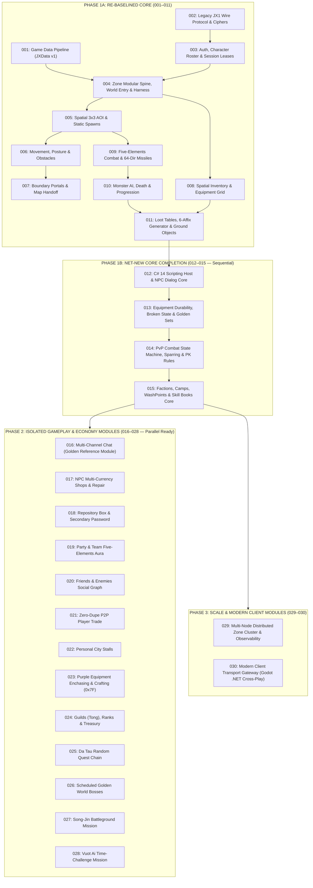

# JXServer Master Specifications Roadmap & SpecKit Playbook (`001`–`030`)

This document is the authoritative specification catalog and **Spec-Driven Development (`/speckit` + `/teamwork`)** execution roadmap for **JXServer**, governed by [`.specify/memory/constitution.md`](../.specify/memory/constitution.md) (`v1.2.0`) and [`docs/data-architecture-standard.md`](data-architecture-standard.md) (`JXData Standard v1`).

---

## 1. Architectural Decomposition Principles

Every feature specification under `specs/` MUST adhere strictly to four governing rules:

1. **Single-Responsibility Vertical Slice (`1 Spec = 1 Bounded Capability`)**:
   - No specification may bundle unrelated domains together. Each spec owns a clearly bounded set of network packets, zone commands/tick systems (or control-plane services), persistence contracts, and acceptance tests.
2. **Core First, Plug-in Modules Second (`Open/Closed Zone Spine`)**:
   - **Phase 1 (`001`–`015` — Core Engine & Character)**: Built sequentially to establish and freeze the data pipeline, wire transport, lease-fenced control plane, open/closed 18-Hz `MapZoneWorker` spine, spatial `3x3` AOI, movement, portals, inventory, combat, monster AI, loot generation, C# 14 scripting host, durability/set math, PvP rules, and faction/skill progression.
   - **Phase 2 (`016`–`028` — Gameplay, Social & Economy Modules)**: 100% decoupled plug-in modules (`IZoneModule`, `IZoneCommandHandler<T>`, `IZoneTickSystem`, `PlayerFeatureSlotKey<T>`, domain-segregated outbound channels, and isolated EF Core `IEntityTypeConfiguration<T>` tables) that NEVER modify the core zone loop and can be developed in parallel by independent `/teamwork` teams.
   - **Phase 3 (`029`–`030` — Scale & Modern Client Transport Modules)**: Infrastructure and cross-play transport extensions (`Distributed Cluster` and `Modern Client Gateway` for Godot .NET) requiring zero changes to gameplay rules.
3. **Engine-First, Script-Trigger Thinness**:
   - Core mechanics and gameplay modules (Shops, Repository Box, Crafting, Guilds, Parties, Trade) MUST operate and be testable directly via typed commands/packets without requiring an interactive NPC dialog script to function. Scripts in `JXServer.Scripts` act strictly as thin triggers (`ctx.OpenShop(...)`, `ctx.OpenRepositoryBox()`, etc.).
4. **Mandatory 3-Tier Self-Testability**:
   - Every spec is considered `Converged` only when verified by automated tests across applicable tiers:
     - **Tier 1 — Deterministic `ZoneSimulationHarness`**: Virtual frame stepping (`1,000` frames in `< 5ms` via controllable time/seed, zero live sockets, zero external DB).
     - **Tier 2 — Concurrency & Lease-Fencing Tests**: Validates monotonic `LeaseEpoch` fencing and zero-dupe transactional guarantees at the Control Plane.
     - **Tier 3 — Symmetric Wire & Loopback Bot Tests**: Verifies byte-exact packet framing, `KsgStreamCipher` stream state, and `TCVN3`/`GBK` ↔ `UTF-8` boundary transcoding compatible with `game.exe` and `jx-swarm`.

---

## 2. Dependency Topology

---

## 3. Master Catalog of 30 Specifications

### Phase 1A — Re-baselined Core Foundations (`001`–`011`)
*Derived from existing verified implementations and refactored onto the Open/Closed Zone Spine, then audited via `/speckit-analyze` and `/speckit-converge`.*

| ID | Spec Directory | Single-Responsibility Scope | Primary Verification Gate |
| :--- | :--- | :--- | :--- |
| **`001`** | `specs/001-core-game-data-pipeline` | `JXData Standard v1` (`schemas/*.schema.json`, `data/**/*.json` → `MemoryPack` `artifacts/*.pack`), immutable `I*Catalog` registries in `JXServer.GameAssets` (zero runtime legacy file parsers), and offline `tools/JXServer.DataExporter`. | Schema validation across 100% of `data/**/*.json` + zero-copy `.pack` catalog load parity tests. |
| **`002`** | `specs/002-core-legacy-wire-protocol` | 2-byte length-prefixed TCP framing (`JxFramePipeProcessor`), `ProtocolSizeTable`, 44-byte handshake key obfuscation, `KsgStreamCipher`, second-layer XOR cipher, and boundary `TCVN3`/`GBK` ↔ `UTF-8` transcoders. | Symmetric byte-for-byte unit test vectors (`FramingAndCipherTests`) and malformed frame isolation. |
| **`003`** | `specs/003-core-auth-roster-and-leases` | Bishop Gateway (`5622`), account login (`0x41`) with dev auto-provisioning, 3-slot character CRUD (`0x37`, `0x45`, `0x3A`, `0x64`), monotonic `SessionLease` fencing (`bKickOnline`), and single-use 16-byte world handoff tickets (`0x34`). | Dual-login race serialization, orphaned ticket expiry, and `SessionLeaseFencingIntegrationTests`. |
| **`004`** | `specs/004-core-zone-spine-and-world-entry` | Open/Closed 18-Hz `MapZoneWorker` spine (`IZoneModule`, `IZoneCommandHandler<T>`, `IZoneTickSystem`, `PlayerFeatureSlotKey<T>`, per-session fault isolation), domain-segregated outbound channels, foundational `Character`/`CharacterItem` persistence fields (`TaskValues`, `RepositoryPasswordHash`, `IsBroken`, `EnchaseLevel`), world entry (`0x42` → `0x49/0x44/0x45/0x46/0x43`), heartbeats (`0x82/0x70/0x99`), and `ZoneSimulationHarness`. | Step `1,000` virtual frames in `< 5ms`, plug-in fault containment test, and full world-entry loopback test. |
| **`005`** | `specs/005-core-spatial-aoi-and-spawns` | `SpatialRegionGrid` (`16x32` cells / `512x1024` Mps), entering/leaving `3x3` region set-difference visibility (`0x4C`, `0x4D`, `0x4E`), on-demand entity queries (`0x48`, `0x49`), and static NPC/monster placement from `*.map.json`. | Multi-entity `3x3` boundary crossing diff tests and `HighDensityAoiBenchmarkTests`. |
| **`006`** | `specs/006-core-movement-and-obstacles` | Anti-cheat `dwCheckValue` verification, deterministic per-frame walk/run progression (`0x4B`→`0x50`, `0x4C`→`0x51`), jump (`0x4E`→`0x54`), sit/stand posture & vital regeneration (`0x71`→`0x53`), and `Obstacle_Full` path clamping. | Walk/run obstacle clamping, invalid checksum rejection, and sitting vital regen frame accuracy in `ZoneSimulationHarness`. |
| **`007`** | `specs/007-core-portals-and-map-handoff` | Edge-triggered cell `TrapId` detection (`LastTriggeredTrapId` anti-loop), town-gate `FightMode` (`0 ↔ 1`) toggles, same-node in-memory `NewWorld` transitions (`0x49` + `0x4E` without cipher reset), and cross-node redirect (`0x35`). | Portal bounce/level-gate checks and seamless cross-map transition without socket drop. |
| **`008`** | `specs/008-core-inventory-and-equipment` | Spatial container grids (`pos_hand`, `pos_equip` 15 parts, `pos_equiproom` `6x10`, `pos_immediacy` belt), `width x height` footprint collision, item move/swap/split/drop (`0x5B`, `0x85`, `0x5E`, `0x83`), equipping stat & Five-Elements hidden affix activation chain, potion regen (`0x59`), and Town Portal (`Thổ Địa Phù`). | 2D footprint collision matrix, 5-element hidden affix activation ring tests, and cursor-hand disconnect safety. |
| **`009`** | `specs/009-core-combat-and-missiles` | Skill execution (`0x4D`, wrapped `0x87`), aura switching (`0x6F`), cooldown/mana/range checks, deterministic 64-direction fixed-point `ActiveMissileSlot` simulation, Five-Elements damage & resistance math, and Cold/Poison/Stun status effects (`0x56` `do_hurt`). | 64-direction trig vector tests, Five-Elements damage formula parity, and multi-projectile burst determinism. |
| **`010`** | `specs/010-core-monster-ai-and-progression` | 18-Hz monster state machine (`Patrol → Aggro → Attack → Leash → Dead/Respawn`), XP & level-up thresholds, attribute (`0x57`→`0x5D`) and skill point (`0x58`→`0x5E`) allocation, player death (`0x57`), and town revival (`0x74`→`0x89`). | Full patrol-aggro-leash-respawn cycle, multi-level XP overflow, and player death/revive state reset in `ZoneSimulationHarness`. |
| **`011`** | `specs/011-core-loot-and-item-generation` | Weighted `LootTable` evaluation (`treasureDropCount`), `KItemGenerator` (`m_wVersion = 4`) white & 6-affix Blue equipment rolling (`weightsByEquipPart`/`Series`/Luck), `GroundObjectSlot` lifecycle (`0x64`/`0x67`), killer ownership protection window, and atomic pickup (`0x5A`). | 10,000-item affix distribution verification and same-frame concurrent pickup race test (zero duplication). |

---

### Phase 1B — Net-New Core Completion (`012`–`015`)
*Built sequentially to complete and freeze 100% of core character, item, combat, and scripting mechanics.*

| ID | Spec Directory | Single-Responsibility Scope | Primary Verification Gate |
| :--- | :--- | :--- | :--- |
| **`012`** | `specs/012-core-csharp-scripting-host` | `JXServer.Scripts` C# 14 Fluent Scripting API (`INpcDialogScript`, `IItemUsageScript`, `IMissionController`), collectible `AssemblyLoadContext` hot-reload, NPC dialog wire protocol (`0x6E` `c2s_dialognpc` ↔ `0x63` `s2c_scriptaction` `Say`/`Talk`), and `TaskValues` script helpers. | Hot-reload modified C# 14 dialog script during live 18-Hz ticks with zero memory leak and per-session callback isolation. |
| **`013`** | `specs/013-core-equipment-durability-and-sets` | Combat weapon/armor durability abrasion, `IsBroken` stat suspension when durability hits `0` (and restoration on repair), Golden equipment fixed affixes (`fixedMagicAffixes`), and multi-piece set bonus activation (`equipmentSets`). | Equip/unequip partial vs. full Golden sets and abrade durability to `0` in `ZoneSimulationHarness`, verifying exact stat deltas. |
| **`014`** | `specs/014-core-pk-combat-rules` | Full PvP relation & PK state machine (`Peaceful`/`Combat`/`Slaughter`, switch cooldowns), 1v1 Sparring (`Tỷ thí`), Enmity (`Cừu sát`), `PkValue` increments, and death penalties (`pkRules`: XP loss, money/item drop rules). | Exhaustive `Camp × PkMode × Relation` target matrix tests; verify Sparring death incurs zero XP/drop penalty while Slaughter increments `PkValue`. |
| **`015`** | `specs/015-core-factions-and-skills` | Five-Elements series → 10 Factions eligibility, `Camp` transitions (`Chính`/`Tà`/`Trung lập` + ` Xuất sư`), faction skill tree grant/sync, attribute/skill point reset (`WashPoints` / Tẩy Tủy), and `IItemUsageScript` skill/stat books (*Võ Lâm Mật Tịch*, *Tẩy Tủy Kinh*, 90x/120x books). | Join/graduate across all 5 series → 10 factions, reject invalid series-faction pairs, and verify exact point conservation on `WashPoints`. |

---

### Phase 2 — Isolated Gameplay, Social & Economy Modules (`016`–`028`)
*Plug-in modules (`IZoneModule` + dedicated domain outbound channel + isolated persistence tables). Zero edits to core loop; eligible for parallel `/teamwork` execution.*

| ID | Spec Directory | Single-Responsibility Scope |
| :--- | :--- | :--- |
| **`016`** | `specs/016-module-chat-channels` | **Golden Reference Plug-in Module** *(re-baselined from legacy `002`)*: Nearby speech (`0x52`→`0x5B`), structured multi-channel routing (`0x56`→`0x7E` across Nearby, World, Whisper, Party, Faction, Guild), subscription bitmasks (`0x60`), and system broadcasts (`0xFB`). |
| **`017`** | `specs/017-module-npc-shops` | `IShopCatalog` (`data/shops/*.shops.json`), NPC shop open/buy/sell (`Gold`, `FuYuan`, `Repute`, `Honor`, `BattleScore`, `Coin`), and standard/enhanced equipment durability repair pricing. |
| **`018`** | `specs/018-module-repository-box` | Personal storage box (`pos_repositoryroom` + expandable tabs), atomic inventory ↔ repository money deposit/withdrawal, secondary password lock/unlock/change verification, and revival point binding. |
| **`019`** | `specs/019-module-party` | In-memory party lifecycle (invite, join, leave, kick, transfer leader, toggle open/close), AOI-bounded party XP sharing formula, and leader Five-Elements resistance aura (`teamResistEffects`). |
| **`020`** | `specs/020-module-social-relations` | Persistent `SocialRelations` aggregate (Friends/Hảo hữu, Enemies/Cừu nhân, Blacklist), mutual friend handshakes, cross-zone online/offline status notifications, and auto-recording PvP killers as enemies. |
| **`021`** | `specs/021-module-p2p-trade` | Two-phase player-to-player trade state machine (*Invite → Place Items/Gold → Lock → Confirm*) backed by atomic lease-fenced Control-Plane journaled swap and `TradeAuditLogs` (strictly zero-dupe on abrupt disconnect). |
| **`022`** | `specs/022-module-player-stalls` | Personal town market stalls: price tagging per bag item, AOI stall banner broadcast, spectator browse catalog, and atomic buyer-to-seller currency/item settlement. |
| **`023`** | `specs/023-module-purple-crafting` | Blacksmith enchasing UI (`0x7F`):玄晶 (`Huyền Tinh`) compounding, magic ore attribute extraction, and 6-socket Purple equipment enchasing (`craftingRecipes` probability curves + `EnchaseLevel` persistence). |
| **`024`** | `specs/024-module-guilds-tong` | Persistent `Guilds` & `GuildMembers` aggregates: guild creation requirements (*Nhạc Vương Kiếm* + leadership/repute), hierarchy/titles (Bang chủ, Trưởng lão, Đường chủ, Bang chúng), guild treasury, camp alignment, and guild chat integration. |
| **`025`** | `specs/025-module-quest-datau` | Repeatable *Dã Tẩu* (Seasoned Traveler) 8,000-quest chain engine (`JXServer.Scripts` + declarative reward milestone tables): item/affix delivery, *Đồ Chí*/*Mật Chí* hunting, cancel tokens, and cumulative milestone rewards. |
| **`026`** | `specs/026-module-world-bosses` | Scheduled *Đại Hoàng Kim Boss* spawner (`goldboss.txt` 5-elemental innate damage profiles), world-wide spawn/slain announcements, top-damage/party attribution, and high-tier boss loot pools. |
| **`027`** | `specs/027-module-battleground-songjin` | `IMissionController` Song-Jin Battleground (`Tống Kim` maps `324`–`385` via `namedPointGroups`): two-camp registration phases, kill/streak/Marshal scoring, live scoreboard sync, and Quartermaster point exchange. |
| **`028`** | `specs/028-module-mission-vuotai` | `IMissionController` Time-Challenge Dungeon (`Vượt Ải` / *Thách Thức Thời Gian*): party entry ticket consumption, sequential timed monster/boss wave clears, wipe/timeout handling, and completion XP/chest rewards. |

---

### Phase 3 — Scale & Modern Client Transport Modules (`029`–`030`)
*Infrastructure scaling and next-generation Godot .NET cross-play adapter.*

| ID | Spec Directory | Single-Responsibility Scope |
| :--- | :--- | :--- |
| **`029`** | `specs/029-module-distributed-cluster` | Distributed `IZoneClusterRouter` over gRPC/Redis across multi-process `ZoneServer` nodes, zero-stall cross-node map handoff (`0x35`), idle zone hibernation (`0%` CPU when empty), GM Administration API, and OpenTelemetry p99 tick metrics/traces. |
| **`030`** | `specs/030-module-modern-gateway` | `JXServer.Adapter.Modern` & shared `JXServer.Protocol.Modern` (`QUIC`/`WebTransport` + UTF-8 `MemoryPack` schemas) enabling a 60–144 FPS **Godot 4 (.NET)** client (sharing `JXServer.Primitives` & `JXServer.GameAssets` `.pack` bundles) to cross-play seamlessly on the same zones alongside legacy `game.exe` clients. |

---

## 4. SpecKit & `/teamwork` Operational Playbook

### 4.1 Standard Single-Spec SDD Lifecycle
Every specification progresses through the gated SpecKit pipeline:
1. **`/speckit-specify`**: Author technology-agnostic `spec.md` (`WHAT` & `WHY`) and pass 16/16 items in `checklists/requirements.md`. Keep C# class names, wire opcodes, and EF Core details out of `spec.md` (place them in `plan.md` & `contracts/`).
2. **`/speckit-clarify`**: Resolve up to 5 high-impact scope/edge-case ambiguities interactively before planning.
3. **`/speckit-plan`**: Generate `plan.md`, `research.md`, `data-model.md`, `contracts/*.md`, and `quickstart.md` with explicit Constitution `v1.2.0` gate checks.
4. **`/speckit-tasks`**: Generate dependency-ordered `tasks.md` grouped by User Story (`[US1]`, `[US2]`...) with `[P]` parallel markers and exact one-type-per-file paths.
5. **`/speckit-analyze`**: Read-only consistency audit across `spec.md` ↔ `plan.md` ↔ `tasks.md` ↔ `constitution.md` before writing code.
6. **`/speckit-implement`**: Execute tasks phase-by-phase with zero warnings (`TreatWarningsAsErrors=true`) and 3-tier automated tests.
7. **`/speckit-converge`**: Final verification audit against actual C# source code until `✅ Converged` with zero gaps.

### 4.2 Running Parallel Teams (`1 Spec = 1 Team`) in Phase 2 (`017`–`028`)
When running multiple `/teamwork` workers or conversations concurrently after `015` is merged:
1. **Mandatory Workspace Isolation (`workspace: "share"` / Git Worktree)**:
   - SpecKit PowerShell scripts (`setup-plan.ps1`, `setup-tasks.ps1`, `check-prerequisites.ps1`) read and write `.specify/feature.json`. Every concurrent Spec Team MUST run inside its own isolated Git worktree (`workspace: "share"`) so `.specify/feature.json` never collides across teams.
2. **Explicit `SPECIFY_FEATURE_DIRECTORY` Assignment**:
   - Never rely on auto-incrementing `NNN` across concurrent branches; always pass the exact pre-assigned directory from Section 3 above (e.g., `SPECIFY_FEATURE_DIRECTORY=specs/017-module-npc-shops`).
3. **Golden Reference Pattern (`016-module-chat-channels`)**:
   - Every Phase 2 team MUST follow the exact module registration pattern established by `016-module-chat-channels` (`IZoneModule` + `IZoneCommandHandler` + `PlayerFeatureSlotKey` + dedicated outbound notification channel + isolated `ZoneSimulationHarness` suite), touching zero lines of `MapZoneWorker.cs`.
4. **Wave Execution (`3–4` Specs per Wave)**:
   - Execute Phase 2 in waves of 3–4 concurrent Spec Teams, merging each converged wave cleanly into `develop` before launching the next wave.
