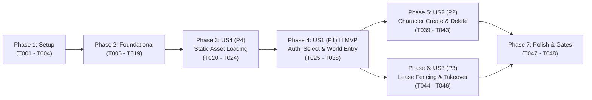

# Tasks: Foundational Gateway Authentication, Character Lifecycle & World Entry

**Input**: Design documents from `/specs/001-gateway-world-entry/` (`spec.md`, `plan.md`, `research.md`, `data-model.md`, `contracts/`, `quickstart.md`)

**Prerequisites**: `plan.md` (required), `spec.md` (required for user stories), `research.md`, `data-model.md`, `contracts/`

**Tests**: Included per Constitution Verification Gates 2, 3, and 4 (`JXServer.Protocol.Tests`, `JXServer.ZoneEngine.Tests`, and `JXServer.Integration.Tests`).

**Organization**: Tasks are grouped by phase and user story (`US1` P1, `US2` P2, `US3` P3, `US4` P4) so each story can be implemented, tested, and validated as an independent increment while strictly enforcing **One-Type-Per-File**, pluralized feature directories, **ABP Framework DDD** naming, and the **5 Real-Time 18-Hz Game Server** naming conventions.

## Format: `[ID] [P?] [Story] Description`

- **[P]**: Can run in parallel (different files, no dependencies on incomplete tasks)
- **[Story]**: Which user story this task belongs to (`[US1]`, `[US2]`, `[US3]`, `[US4]`)
- Every task specifies the exact target file path(s) in `d:\Projects\jx-server`

---

## Phase 1: Setup (Shared Solution & Project Scaffolding)

**Purpose**: Initialize the `.NET 10` (`net10.0`, C# 14) XML solution (`JXServer.slnx`), centralized build/package configurations, and the 9 `src/` + 3 `tests/` project files per `plan.md`.

- [X] T001 Create centralized build configuration (`TargetFramework=net10.0`, `LangVersion=14`, `Nullable=enable`, `ImplicitUsings=enable`, `TreatWarningsAsErrors=true`, `AnalysisLevel=latest`, `AllowUnsafeBlocks=true`) in `Directory.Build.props`
- [X] T002 Create Central Package Management configuration (`Microsoft.Extensions.Hosting` `10.0.0`, `System.IO.Pipelines` `10.0.0`, `System.Text.Encoding.CodePages` `10.0.0`, `Microsoft.EntityFrameworkCore.SqlServer` `10.0.0`, `Microsoft.EntityFrameworkCore.Sqlite` `10.0.0`, `Microsoft.EntityFrameworkCore.InMemory` `10.0.0`, `Microsoft.Extensions.TimeProvider.Testing` `10.0.0`, `Microsoft.NET.Test.Sdk` `17.13.0`, `xunit.v3` `2.0.0`, `xunit.runner.visualstudio` `3.0.2`) in `Directory.Packages.props`
- [X] T003 Create the 9 source project files (`src/JXServer.Primitives/JXServer.Primitives.csproj`, `src/JXServer.GameAssets/JXServer.GameAssets.csproj`, `src/JXServer.Contracts/JXServer.Contracts.csproj`, `src/JXServer.Domain/JXServer.Domain.csproj`, `src/JXServer.ZoneEngine/JXServer.ZoneEngine.csproj`, `src/JXServer.Application/JXServer.Application.csproj`, `src/JXServer.Infrastructure/JXServer.Infrastructure.csproj`, `src/JXServer.Adapter.LegacyJX1/JXServer.Adapter.LegacyJX1.csproj`, `src/JXServer.Host/JXServer.Host.csproj`) and 3 test project files (`tests/JXServer.Protocol.Tests/JXServer.Protocol.Tests.csproj`, `tests/JXServer.ZoneEngine.Tests/JXServer.ZoneEngine.Tests.csproj`, `tests/JXServer.Integration.Tests/JXServer.Integration.Tests.csproj`) with inward project references and register all 12 projects in `JXServer.slnx`
- [X] T004 [P] Copy the verified 5,679-entry `g_uPublicKeys` binary fixture (`22,716` bytes, SHA-256 `5491f08643c87d4ad6c08e3b5f44457acbc78a3cd0d288b6d6f4d99dafe66047`) from `d:\Projects\jx-swarm\docs\fixtures\keys\g_uPublicKeys.bin` into `docs/fixtures/keys/g_uPublicKeys.bin` and embed/link it in `src/JXServer.Adapter.LegacyJX1/JXServer.Adapter.LegacyJX1.csproj`

---

## Phase 2: Foundational (Blocking Prerequisites Across All Stories)

**Purpose**: Core `Primitives`, boundary `TCVN3`/`GBK` transcoders, `Domain` Aggregate Roots & Repository interfaces, EF Core 10 `SQL Server` + `SQLite` persistence, and wire-level framing/cipher primitives that MUST be complete before user story implementation.

**⚠️ CRITICAL**: No user story work can begin until this phase is complete.

### 2.1 Primitives Tier (`JXServer.Primitives`)

- [X] T005 [P] Create account constants (`MinUserNameByteLength = 1`, `MaxUserNameByteLength = 31`, `FixedAccountBufferSize = 32`, `PasswordMd5HexLength = 32`, `FixedPasswordBufferSize = 64`, `RequiredProtocolVersion = 0x00000041`) in `src/JXServer.Primitives/Accounts/AccountConsts.cs`, `AccountStatus` enum (`Active = 0`, `Frozen = 1`, `Locked = 2`) in `src/JXServer.Primitives/Accounts/AccountStatus.cs`, and `LoginResultCode` enum (`Success = 0x00050001`, `Failed = 0x00050002`, `AccountOrPasswordError = 0x00050003`, `AccountAlreadyOnline = 0x00050004`, `Timeout = 0x00050005`, `InvalidProtocolVersion = 0x0005000A`, `AccountFrozen = 0x0005000B`) in `src/JXServer.Primitives/Accounts/LoginResultCode.cs`
- [X] T006 [P] Create character constants (`MaxRolesPerAccount = 3`, `MinNameByteLength = 6`, `MaxNameByteLength = 30`, `FixedRoleNameBufferSize = 32`, `MaxSkillSlots = 80`, `ExpHighDivisor = 2_000_000_000L`) in `src/JXServer.Primitives/Characters/CharacterConsts.cs`, `CharacterGender` enum (`Male = 0`, `Female = 1`) in `src/JXServer.Primitives/Characters/CharacterGender.cs`, `ElementSeries` enum (`Metal = 0`, `Wood = 1`, `Water = 2`, `Fire = 3`, `Earth = 4`) in `src/JXServer.Primitives/Characters/ElementSeries.cs`, and `EntityKind` enum (`Monster = 0`, `Player = 1`, `Partner = 2`, `DialogNpc = 3`) in `src/JXServer.Primitives/Characters/EntityKind.cs`
- [X] T007 [P] Create session lease constants (`DefaultHandoffTicketTtlSeconds = 30`, `DefaultHeartbeatIntervalSeconds = 5`, `DefaultHeartbeatTimeoutSeconds = 15`) in `src/JXServer.Primitives/SessionLeases/SessionLeaseConsts.cs` and `SessionLeaseState` enum (`Offline = 0`, `GatewayAuthenticated = 1`, `HandoffIssued = 2`, `WorldAttaching = 3`, `InWorld = 4`) in `src/JXServer.Primitives/SessionLeases/SessionLeaseState.cs`
- [X] T008 [P] Create spatial coordinate constants (`CellWidthMps = 32`, `CellHeightMps = 32`, `RegionWidthCells = 16`, `RegionHeightCells = 32`, `RegionWidthMps = 512`, `RegionHeightMps = 1024`, `TicksPerSecond = 18`) in `src/JXServer.Primitives/WorldZones/WorldCoordinateConsts.cs` and `WorldPosition` readonly record struct (`ushort MapId`, `int MpsX`, `int MpsY`, with computed `RegionX = MpsX / 512`, `RegionY = MpsY / 1024`, `PackedRegionId = (RegionY << 16) | RegionX`, `CellX = (MpsX % 512) / 32`, `CellY = (MpsY % 1024) / 32`, `OffX = (ushort)((MpsX % 32) << 10)`, `OffY = (ushort)((MpsY % 32) << 10)`) in `src/JXServer.Primitives/WorldZones/WorldPosition.cs`
- [X] T009 [P] Create structured domain error codes (`JXServer:Account:0001..0003`, `JXServer:Character:0001..0005`, `JXServer:Session:0001..0002`) in `src/JXServer.Primitives/ErrorCodes/JXServerErrorCodes.cs` and `BusinessException` in `src/JXServer.Primitives/ErrorCodes/BusinessException.cs`
- [X] T010 [P] Implement boundary-only Vietnamese `TCVN3` $\leftrightarrow$ `UTF-8` transcoder with null-termination stripping in `src/JXServer.Primitives/Encodings/Tcvn3Encoding.cs`, `GBK` (`CP936`) helper in `src/JXServer.Primitives/Encodings/GbkEncoding.cs`, and 32-char uppercase MD5 hex helper (`KSG_PASSWORD`) in `src/JXServer.Primitives/Encodings/KsgPasswordHasher.cs`

### 2.2 Domain Aggregates & EF Core 10 Persistence (`JXServer.Domain` & `JXServer.Infrastructure`)

- [X] T011 [P] Create `Account` aggregate root (`Guid Id`, `string UserName` `1..31` ASCII chars, `string PasswordHashUpperMd5` `32` chars, `string? SecondaryPasswordHashUpperMd5`, `AccountStatus Status`, `uint RemainingTimeSeconds`, `long CurrentLeaseEpoch`, `VerifyPassword`, `VerifyDeletionPassword` falling back to primary password/session when secondary password is null, `AdvanceLeaseEpoch`) in `src/JXServer.Domain/Accounts/Account.cs` and `IAccountRepository` in `src/JXServer.Domain/Accounts/IAccountRepository.cs`
- [X] T012 [P] Create `CharacterSkillValue` value object (`ushort SkillId`, `byte BaseLevel`, `byte BonusLevel`, `ushort ExpPercent`) in `src/JXServer.Domain/Characters/CharacterSkillValue.cs`, `Character` aggregate root (`Guid Id`, `Guid AccountId`, `byte SlotIndex` `0..2`, `string RoleName` unique UTF-8 `6..30` TCVN3 bytes, `CharacterGender Gender`, `ElementSeries Series`, `byte Level` `1..255`, `long Experience`, `int LeadExperience`, `ushort MapId`, `int RevivalMapId`, `int RevivalPointId`, `int MapMpsX`, `int MapMpsY`, vitals, base attributes, money, faction fields, `IReadOnlyList<CharacterSkillValue> Skills`, `UpdateWorldSnapshot`) in `src/JXServer.Domain/Characters/Character.cs`, and `ICharacterRepository` (including permanent `DeleteAsync`) in `src/JXServer.Domain/Characters/ICharacterRepository.cs`
- [X] T013 [P] Create `SessionLease` aggregate root (`Guid AccountId`, `string UserName`, `long LeaseEpoch`, `SessionLeaseState State`, `Guid? ActiveCharacterId`, `string? ActiveRoleName`, `Guid? HandoffTicketGuid`, `ushort? AssignedMapId`, `DateTimeOffset IssuedAtUtc`, `DateTimeOffset? TicketExpiresAtUtc`, `DateTimeOffset LastHeartbeatAtUtc`, `BeginGatewaySession`, `IssueWorldHandoffTicket`, `ConsumeWorldHandoffTicket`, `RecordHeartbeat`, `Release`) in `src/JXServer.Domain/SessionLeases/SessionLease.cs`, `ISessionLeaseRepository` in `src/JXServer.Domain/SessionLeases/ISessionLeaseRepository.cs`, and `ISessionEvictionNotifier` in `src/JXServer.Domain/SessionLeases/ISessionEvictionNotifier.cs`
- [X] T014 Create `PersistenceOptions` (`DatabaseProvider` supporting `"Sqlite"` and `"SqlServer"`, `ConnectionString`) in `src/JXServer.Infrastructure/Configuration/PersistenceOptions.cs` and `JXServerDbContext` (configuring UTF-8 `Accounts` and `Characters` tables, unique indexes on `UserName` and `RoleName`, max 3 characters per `AccountId`, and EF Core 10 `ToJson()` owned collection for `Skills`) in `src/JXServer.Infrastructure/EntityFrameworkCore/JXServerDbContext.cs`
- [X] T015 [P] Implement `EfCoreAccountRepository` in `src/JXServer.Infrastructure/Accounts/EfCoreAccountRepository.cs`, `EfCoreCharacterRepository` in `src/JXServer.Infrastructure/Characters/EfCoreCharacterRepository.cs`, and thread-safe keyed `InMemorySessionLeaseRepository` in `src/JXServer.Infrastructure/SessionLeases/InMemorySessionLeaseRepository.cs`
- [X] T016 Create `DatabaseInitializerHostedService` in `src/JXServer.Infrastructure/EntityFrameworkCore/DatabaseInitializerHostedService.cs` and DI registration extension `InfrastructureServiceCollectionExtensions` in `src/JXServer.Infrastructure/InfrastructureServiceCollectionExtensions.cs`

### 2.3 Wire Framing, Handshake & Stream Cipher (`JXServer.Adapter.LegacyJX1`)

- [X] T017 [P] Implement 5,679-entry `g_uPublicKeys` loader (`KsgPublicKeyTable`) in `src/JXServer.Adapter.LegacyJX1/Ciphers/KsgPublicKeyTable.cs`, `HandshakeKeyObfuscator` (`ObfuscateKey` / `DeobfuscateKey` with `0x2E6D2399` and `0x2E6D23CF`) in `src/JXServer.Adapter.LegacyJX1/Ciphers/HandshakeKeyObfuscator.cs`, `KsgStreamCipher` (`KSG_DecodeEncode` + LCG key rotation `_rol(uKey, 1) * 0x10A860C1u + 0xEE57FD49u` / `uKey * 31u + 0x08088405u`) in `src/JXServer.Adapter.LegacyJX1/Ciphers/KsgStreamCipher.cs`, and `SecondLayerXorCipher` (`0x3042` role-list cipher and `0x38BC` role-select cipher) in `src/JXServer.Adapter.LegacyJX1/Ciphers/SecondLayerXorCipher.cs`
- [X] T018 [P] Implement `ProtocolOpcodes` constants in `src/JXServer.Adapter.LegacyJX1/Packets/ProtocolOpcodes.cs`, `ProtocolSizeTable` (`gInitServerProtocolSize` and `gInitClientProtocolSize` validation rules) in `src/JXServer.Adapter.LegacyJX1/Framing/ProtocolSizeTable.cs`, `AccountBeginS2CPacket` (`0x20`, `42B` payload / `44B` wire frame) in `src/JXServer.Adapter.LegacyJX1/Packets/AccountBeginS2CPacket.cs`, and `System.IO.Pipelines` 2-byte length-prefixed frame processor `JxFramePipeProcessor` (`wFrameLength = PayloadLength + 2`, valid range `3..65535`) in `src/JXServer.Adapter.LegacyJX1/Framing/JxFramePipeProcessor.cs`
- [X] T019 [P] Write deterministic unit tests for `Tcvn3Encoding`, `HandshakeKeyObfuscator`, `KsgPublicKeyTable` SHA-256 verification, `KsgStreamCipher` round-trip test vectors, `SecondLayerXorCipher` (`0x3042` & `0x38BC`), and `JxFramePipeProcessor` fragmentation/malformed frame rejection in `tests/JXServer.Protocol.Tests/FramingAndCipherTests.cs`

**Checkpoint**: Foundation ready — Primitives, EF Core 10 persistence, and Legacy JX1 framing/ciphers are verified.

---

## Phase 3: User Story 4 - Static World Map & Configuration Asset Loading (Priority: P4 — Foundational Asset Catalog Prerequisite)

**Goal**: Load and validate `worldset.ini`, `maplist.ini`, `*.wor`, `Region_S.dat` obstacle matrices (from unpacked `/maps` or UCL-compressed `pak/maps.pak`), `nativeplacelist.ini`, `revivalid.ini`, `revivepos.ini`, `newplayerini00..09.ini`, `level_add.txt`, and `goddess_rolename.flt` on startup, halting before opening client ports if critical assets are missing (`FR-012`).

**Note on Execution Order**: Placed immediately before `US1`/`US2` because both World Entry (`US1`) and Character Creation (`US2`) depend on `IMapCatalog` and `IPlayerTemplateCatalog`.

**Independent Test**: Run `dotnet test tests/JXServer.ZoneEngine.Tests` pointed at `d:\Projects\jx-linux-bin\server1` and `gateway` to verify Map `53` (`Ba Lăng Huyện`) obstacle grids, all 8 starter village coordinates, and all 10 `(ElementSeries, CharacterGender)` character templates load with 100% accuracy.

### Implementation & Tests for User Story 4

- [X] T020 [P] [US4] Implement `PakFilePathHasher` (`g_FileName2Id` @ `0x08217fb0` with signed-char promotion and `^ 0x12345678u`) in `src/JXServer.GameAssets/Archives/PakFilePathHasher.cs`, `UclNrv2bDecompressor` (`ucl_nrv2b_decompress_8` @ `0x0822ab70`) in `src/JXServer.GameAssets/Archives/UclNrv2bDecompressor.cs`, and `XPackArchiveReader` (`PACK` header + binary search over sorted 16-byte `XPackIndexInfo` entries) in `src/JXServer.GameAssets/Archives/XPackArchiveReader.cs`
- [X] T021 [P] [US4] Create `GameAssetsOptions` (`ServerRootPath`, `GatewayRootPath`, `DefaultFallbackStarterVillageMapId = 53`, `FallbackUnloadedStarterVillage = true`) in `src/JXServer.GameAssets/Configuration/GameAssetsOptions.cs`, `IniFileParser` in `src/JXServer.GameAssets/Configuration/IniFileParser.cs`, `TabFileParser` in `src/JXServer.GameAssets/Configuration/TabFileParser.cs`, and source-generated `GameAssetsLogMessages` in `src/JXServer.GameAssets/Logging/GameAssetsLogMessages.cs`
- [X] T022 [P] [US4] Create `MapDescriptor` (`ushort MapId`, `string MapNameUnicode`, `string RawSubPath`, `int RegionBeginX`, `int RegionBeginY`, `int RegionWidth`, `int RegionHeight`) in `src/JXServer.GameAssets/WorldMaps/MapDescriptor.cs`, `RegionObstacleGrid` (`int RegionX`, `int RegionY`, `ReadOnlyMemory<int> CellObstacles` of `16 * 32` `int32` cells from `Region_S.dat` Section `0`) in `src/JXServer.GameAssets/WorldMaps/RegionObstacleGrid.cs`, `IMapCatalog` in `src/JXServer.GameAssets/WorldMaps/IMapCatalog.cs`, and `MapCatalog` (loading `maps/worldset.ini`, `settings/maplist.ini`, and `.wor` + `Region_S.dat` from unpacked disk or `pak/maps.pak`) in `src/JXServer.GameAssets/WorldMaps/MapCatalog.cs`
- [X] T023 [P] [US4] Create `StarterSkillEntry` in `src/JXServer.GameAssets/PlayerTemplates/StarterSkillEntry.cs`, `CharacterBaseTemplate` (for `newplayerini00..09.ini` & `level_add.txt`) in `src/JXServer.GameAssets/PlayerTemplates/CharacterBaseTemplate.cs`, `StarterVillageTemplate` (for the 8 starter villages `53, 20, 99, 100, 101, 121, 153, 174` from `nativeplacelist.ini`, `revivalid.ini`, `revivepos.ini`) in `src/JXServer.GameAssets/PlayerTemplates/StarterVillageTemplate.cs`, `IPlayerTemplateCatalog` in `src/JXServer.GameAssets/PlayerTemplates/IPlayerTemplateCatalog.cs`, and `PlayerTemplateCatalog` (including `goddess_rolename.flt` prohibited name filter validation) in `src/JXServer.GameAssets/PlayerTemplates/PlayerTemplateCatalog.cs`
- [X] T024 [US4] Create startup asset validator & DI registration in `src/JXServer.GameAssets/GameAssetsServiceCollectionExtensions.cs` that halts startup with explicit missing/corrupted file path reporting (`FR-012`), and write unit tests verifying `.pak` hashing/decompression, Map `53` region obstacle loading, and all 10 `newplayerini00..09.ini` templates in `tests/JXServer.ZoneEngine.Tests/GameAssetsCatalogTests.cs`

**Checkpoint**: User Story 4 complete — `IMapCatalog` and `IPlayerTemplateCatalog` load and validate real `jx-linux-bin` assets.

---

## Phase 4: User Story 1 - Gateway Authentication, Character Selection & World Entry (Priority: P1) 🎯 MVP

**Goal**: Enable a client (`game.exe` or `JX-Swarm`) to connect to Bishop (`5622`), authenticate (`0x41` with optional first-login auto-provisioning `FR-003`), receive their character roster (`0x37` encrypted with `0x3042`), select a character (`0x64` obfuscated with `0x38BC`), receive a single-use 16-byte `GUID` handoff ticket (`0x34`), connect to GameServer (`6666`), attach via `0x42`, receive the complete initial world/player/skill/vital sync burst (`0x49`, `0x44`, `0x45`, `0x46`, `0x4C`, `0xA4`, `0x43`), complete `0x43` sync-end handshake, and maintain continuous 18-Hz heartbeat pings (`0x82`/`0x70`/`0x99`).

**Independent Test**: Connect to `JXServer.Host` with a seeded/existing character, select the character, enter Map `53` (`Ba Lăng Huyện`), and verify all initial sync packets and continuous heartbeat exchanges pass in `tests/JXServer.Integration.Tests/GatewayWorldEntryIntegrationTests.cs`.

### 4.1 Contracts, Domain Managers & Application Services for US1

- [X] T025 [P] [US1] Create `AuthenticateAccountInput` in `src/JXServer.Contracts/Accounts/AuthenticateAccountInput.cs`, `AuthenticateAccountResultDto` in `src/JXServer.Contracts/Accounts/AuthenticateAccountResultDto.cs`, and `IAccountAppService` in `src/JXServer.Contracts/Accounts/IAccountAppService.cs`
- [X] T026 [P] [US1] Create `GetCharacterRosterInput` in `src/JXServer.Contracts/Characters/GetCharacterRosterInput.cs`, `CharacterSummaryDto` in `src/JXServer.Contracts/Characters/CharacterSummaryDto.cs`, `CharacterSkillDto` in `src/JXServer.Contracts/Characters/CharacterSkillDto.cs`, `CharacterDto` in `src/JXServer.Contracts/Characters/CharacterDto.cs`, and `ICharacterAppService` in `src/JXServer.Contracts/Characters/ICharacterAppService.cs`
- [X] T027 [P] [US1] Create `SelectCharacterInput` in `src/JXServer.Contracts/SessionLeases/SelectCharacterInput.cs`, `WorldHandoffTicketDto` in `src/JXServer.Contracts/SessionLeases/WorldHandoffTicketDto.cs`, `RedeemHandoffTicketInput` in `src/JXServer.Contracts/SessionLeases/RedeemHandoffTicketInput.cs`, `RedeemHandoffTicketResultDto` in `src/JXServer.Contracts/SessionLeases/RedeemHandoffTicketResultDto.cs`, `ReleaseSessionLeaseInput` in `src/JXServer.Contracts/SessionLeases/ReleaseSessionLeaseInput.cs`, and `ISessionLeaseAppService` in `src/JXServer.Contracts/SessionLeases/ISessionLeaseAppService.cs`
- [X] T028 [US1] Implement `AccountManager` (verifying protocol version `0x41`, account status, password MD5 match, and optional first-login auto-provisioning persisting username + MD5 digest per `FR-003`) in `src/JXServer.Domain/Accounts/AccountManager.cs` and `SessionLeaseManager` (managing `LeaseEpoch`, 16-byte `HandoffTicketGuid` issuance with 30s TTL, and target map verification with unloaded-map fallback to Map `53` per `FR-007`) in `src/JXServer.Domain/SessionLeases/SessionLeaseManager.cs`
- [X] T029 [US1] Implement `AccountAppService` in `src/JXServer.Application/Accounts/AccountAppService.cs`, `SessionLeaseAppService` in `src/JXServer.Application/SessionLeases/SessionLeaseAppService.cs`, `ApplicationLogMessages` in `src/JXServer.Application/Logging/ApplicationLogMessages.cs`, and `ApplicationServiceCollectionExtensions` in `src/JXServer.Application/ApplicationServiceCollectionExtensions.cs`

### 4.2 Sharded 18-Hz Zone Engine (`JXServer.ZoneEngine`) for US1

- [X] T030 [P] [US1] Create `ZoneEngineOptions` in `src/JXServer.ZoneEngine/Configuration/ZoneEngineOptions.cs`, `ZoneEngineLogMessages` in `src/JXServer.ZoneEngine/Logging/ZoneEngineLogMessages.cs`, `IPlayerOutboundSink` in `src/JXServer.ZoneEngine/PlayerSessions/IPlayerOutboundSink.cs`, `PlayerDetachReason` enum in `src/JXServer.ZoneEngine/PlayerSessions/PlayerDetachReason.cs`, and `PlayerZoneState` (`RuntimeNpcId`, `AccountId`, `CharacterId`, `LeaseEpoch`, `RoleNameUnicode`, `MapId`, `CurrentMpsX`, `CurrentMpsY`, vitals, attributes, `ClientToken`, `ClientTick`, `IsSyncCompleted`, `LastSentPingServerTimestamp`, `LastPingReceivedTick`, `OutboundSink`) in `src/JXServer.ZoneEngine/PlayerSessions/PlayerZoneState.cs`
- [X] T031 [P] [US1] Create `IZoneCommand` in `src/JXServer.ZoneEngine/WorldZones/IZoneCommand.cs`, `AttachPlayerZoneCommand` in `src/JXServer.ZoneEngine/PlayerSessions/AttachPlayerZoneCommand.cs`, `CompletePlayerSyncZoneCommand` in `src/JXServer.ZoneEngine/PlayerSessions/CompletePlayerSyncZoneCommand.cs`, `ProcessPlayerPingZoneCommand` in `src/JXServer.ZoneEngine/PlayerSessions/ProcessPlayerPingZoneCommand.cs`, and `DetachPlayerZoneCommand` in `src/JXServer.ZoneEngine/PlayerSessions/DetachPlayerZoneCommand.cs`
- [X] T032 [US1] Implement `MapZoneWorker` (18-Hz `55.5ms` deterministic loop via `TimeProvider` and single-reader `Channel<IZoneCommand>`, handling `AttachPlayerZoneCommand` initial sync burst `0x49`/`0x44`/`0x45`/`0x46`/`0x4C`/`0xA4`/`0x43`, `CompletePlayerSyncZoneCommand` `0x43` $\rightarrow$ `0x46` + `0x4E`, and periodic 5s `0x82` ping / `0x70` verification / `0x99` reply) in `src/JXServer.ZoneEngine/WorldZones/MapZoneWorker.cs`, `IZoneClusterRouter` in `src/JXServer.ZoneEngine/WorldZones/IZoneClusterRouter.cs`, `ZoneClusterRouter` in `src/JXServer.ZoneEngine/WorldZones/ZoneClusterRouter.cs`, `ZoneEngineHostedService` in `src/JXServer.ZoneEngine/WorldZones/ZoneEngineHostedService.cs`, and `ZoneEngineServiceCollectionExtensions` in `src/JXServer.ZoneEngine/ZoneEngineServiceCollectionExtensions.cs`

### 4.3 Wire Packets & TCP Endpoints (`JXServer.Adapter.LegacyJX1`) for US1

- [X] T033 [P] [US1] Create Bishop wire packet structs for US1: `AccountLoginC2SPacket` (`0x41`, `127B`) in `src/JXServer.Adapter.LegacyJX1/Packets/AccountLoginC2SPacket.cs`, `AccountLoginResultS2CPacket` (`0x41`, `127B`) in `src/JXServer.Adapter.LegacyJX1/Packets/AccountLoginResultS2CPacket.cs`, `RoleListResultS2CPacket` (`0x37`, variable `10 + nDataLen` with `0x3042` second-layer XOR) in `src/JXServer.Adapter.LegacyJX1/Packets/RoleListResultS2CPacket.cs`, `SelectCharacterC2SPacket` (`0x64`, `41B` with `0x38BC` second-layer XOR on first `nNameLen` bytes) in `src/JXServer.Adapter.LegacyJX1/Packets/SelectCharacterC2SPacket.cs`, and `NotifyPlayerLoginS2CPacket` (`0x34`, `60B`) in `src/JXServer.Adapter.LegacyJX1/Packets/NotifyPlayerLoginS2CPacket.cs`
- [X] T034 [P] [US1] Create GameServer wire packet structs for US1: `LogicLoginC2SPacket` (`0x42`, `17B`) in `src/JXServer.Adapter.LegacyJX1/Packets/LogicLoginC2SPacket.cs`, `SyncWorldS2CPacket` (`0x49`, `34B`) in `src/JXServer.Adapter.LegacyJX1/Packets/SyncWorldS2CPacket.cs`, `SyncCurPlayerS2CPacket` (`0x44`, `68B`) in `src/JXServer.Adapter.LegacyJX1/Packets/SyncCurPlayerS2CPacket.cs`, `SyncCurPlayerSkillS2CPacket` (`0x45`, `483B`) in `src/JXServer.Adapter.LegacyJX1/Packets/SyncCurPlayerSkillS2CPacket.cs`, `SyncCurPlayerNormalS2CPacket` (`0x46`, `14B`) in `src/JXServer.Adapter.LegacyJX1/Packets/SyncCurPlayerNormalS2CPacket.cs`, `SyncNpcFullS2CPacket` (`0x4C`, variable `34 + NameLen`) in `src/JXServer.Adapter.LegacyJX1/Packets/SyncNpcFullS2CPacket.cs`, `SyncNpcMinPlayerS2CPacket` (`0x4E`, `13B`) in `src/JXServer.Adapter.LegacyJX1/Packets/SyncNpcMinPlayerS2CPacket.cs`, `DisabledFuncFlagS2CPacket` (`0xA4`, `5B`) in `src/JXServer.Adapter.LegacyJX1/Packets/DisabledFuncFlagS2CPacket.cs`, `SyncEndS2CPacket` (`0x43`, `1B`) in `src/JXServer.Adapter.LegacyJX1/Packets/SyncEndS2CPacket.cs`, `SyncEndC2SPacket` (`0x43`, `9B`) in `src/JXServer.Adapter.LegacyJX1/Packets/SyncEndC2SPacket.cs`, `PingS2CPacket` (`0x82`, `5B`) in `src/JXServer.Adapter.LegacyJX1/Packets/PingS2CPacket.cs`, `PingReplyC2SPacket` (`0x70`, `9B`) in `src/JXServer.Adapter.LegacyJX1/Packets/PingReplyC2SPacket.cs`, and `PingReplyS2CPacket` (`0x99`, `5B`) in `src/JXServer.Adapter.LegacyJX1/Packets/PingReplyS2CPacket.cs`
- [X] T035 [US1] Implement Bishop TCP session & packet handlers for US1: `LegacyGatewayOptions` in `src/JXServer.Adapter.LegacyJX1/Configuration/LegacyGatewayOptions.cs`, `LegacyAdapterLogMessages` in `src/JXServer.Adapter.LegacyJX1/Logging/LegacyAdapterLogMessages.cs`, `IBishopPacketHandler` in `src/JXServer.Adapter.LegacyJX1/Bishop/IBishopPacketHandler.cs`, `BishopClientSession` in `src/JXServer.Adapter.LegacyJX1/Bishop/BishopClientSession.cs`, `AccountLoginPacketHandler` (`0x41` $\rightarrow$ `0x41` + `0x37`) in `src/JXServer.Adapter.LegacyJX1/Bishop/AccountLoginPacketHandler.cs`, `SelectCharacterPacketHandler` (`0x64` $\rightarrow$ `0x34`) in `src/JXServer.Adapter.LegacyJX1/Bishop/SelectCharacterPacketHandler.cs`, and `BishopTcpListenerHostedService` (port `5622`) in `src/JXServer.Adapter.LegacyJX1/Bishop/BishopTcpListenerHostedService.cs`
- [X] T036 [US1] Implement GameServer TCP session & packet handlers for US1: `IGameServerPacketHandler` in `src/JXServer.Adapter.LegacyJX1/GameServer/IGameServerPacketHandler.cs`, `GameServerClientSession` (implementing `IPlayerOutboundSink`) in `src/JXServer.Adapter.LegacyJX1/GameServer/GameServerClientSession.cs`, `LogicLoginPacketHandler` (`0x42`) in `src/JXServer.Adapter.LegacyJX1/GameServer/LogicLoginPacketHandler.cs`, `SyncEndPacketHandler` (`0x43`) in `src/JXServer.Adapter.LegacyJX1/GameServer/SyncEndPacketHandler.cs`, `PingReplyPacketHandler` (`0x70` $\rightarrow$ `0x99`) in `src/JXServer.Adapter.LegacyJX1/GameServer/PingReplyPacketHandler.cs`, `GameServerTcpListenerHostedService` (port `6666`) in `src/JXServer.Adapter.LegacyJX1/GameServer/GameServerTcpListenerHostedService.cs`, and `LegacyJX1AdapterServiceCollectionExtensions` in `src/JXServer.Adapter.LegacyJX1/LegacyJX1AdapterServiceCollectionExtensions.cs`
- [X] T037 [US1] Configure `JXServer.Host` composition root in `src/JXServer.Host/Program.cs` and default settings in `src/JXServer.Host/appsettings.json`
- [X] T038 [P] [US1] Write symmetric packet serialization unit tests for all US1 Bishop & GameServer packets in `tests/JXServer.Protocol.Tests/GatewayAndWorldEntryPacketTests.cs` and deterministic 18-Hz `MapZoneWorker` sync & ping unit tests using `FakeTimeProvider` in `tests/JXServer.ZoneEngine.Tests/MapZoneWorkerTests.cs`

**Checkpoint**: User Story 1 (MVP) is complete and independently testable — accounts can authenticate on `5622`, select a character, hand off to `6666`, enter Map `53`, and exchange 18-Hz heartbeats.

---

## Phase 5: User Story 2 - Character Creation, Starter Village Assignment & Deletion (Priority: P2)

**Goal**: Enable authenticated accounts with fewer than 3 characters to create a new character (`0x45` $\rightarrow$ `0x8C` $\rightarrow$ `0x34`) across all 5 elemental series (`Kim`, `Mộc`, `Thủy`, `Hỏa`, `Thổ`) and starter villages (applying unloaded-map fallback to Map `53` when configured per `FR-005`), or delete an existing character (`0x3A` $\rightarrow$ `0x8C`, checking secondary password if set or primary password/session fallback, and permanently freeing both the slot and character name per `FR-006`).

**Independent Test**: Connect to a fresh account with 0 characters, create characters across all 5 elemental series, verify starter attributes match `newplayerini00..09.ini`, and verify character deletion (`0x3A`) immediately frees the slot and name for reuse.

### Implementation & Tests for User Story 2

- [X] T039 [P] [US2] Create `CreateCharacterDto` in `src/JXServer.Contracts/Characters/CreateCharacterDto.cs`, `CreateCharacterResultDto` in `src/JXServer.Contracts/Characters/CreateCharacterResultDto.cs`, `DeleteCharacterDto` in `src/JXServer.Contracts/Characters/DeleteCharacterDto.cs`, `DeleteCharacterResultDto` in `src/JXServer.Contracts/Characters/DeleteCharacterResultDto.cs`, and `UpdateCharacterWorldSnapshotDto` in `src/JXServer.Contracts/Characters/UpdateCharacterWorldSnapshotDto.cs`
- [X] T040 [US2] Implement `CharacterManager` (enforcing `< 3` characters per account, `6..30` TCVN3 byte length, `goddess_rolename.flt` prohibited name filter, global name uniqueness, starter village resolution with fallback to default active village Map `53` per `FR-005`, and initialization from `CharacterBaseTemplate` + `StarterVillageTemplate`) in `src/JXServer.Domain/Characters/CharacterManager.cs` and `CharacterAppService` (`GetCharacterRosterAsync`, `CreateCharacterAsync` issuing `WorldHandoffTicketDto`, and `DeleteCharacterAsync` verifying `Account.VerifyDeletionPassword` and permanently deleting via `ICharacterRepository.DeleteAsync` per `FR-006`) in `src/JXServer.Application/Characters/CharacterAppService.cs`
- [X] T041 [P] [US2] Create wire packet structs for US2: `CreateCharacterC2SPacket` (`0x45`, variable `15 + NameByteLen`) in `src/JXServer.Adapter.LegacyJX1/Packets/CreateCharacterC2SPacket.cs`, `DeleteCharacterC2SPacket` (`0x3A`, `129B`) in `src/JXServer.Adapter.LegacyJX1/Packets/DeleteCharacterC2SPacket.cs`, and `RoleNewDelResponseS2CPacket` (`0x8C`, `42B`) in `src/JXServer.Adapter.LegacyJX1/Packets/RoleNewDelResponseS2CPacket.cs`
- [X] T042 [US2] Implement `CreateCharacterPacketHandler` (`0x45` $\rightarrow$ `0x8C` + `0x34` on success, `0x8C` `bSucceeded = 0` on validation failure) in `src/JXServer.Adapter.LegacyJX1/Bishop/CreateCharacterPacketHandler.cs` and `DeleteCharacterPacketHandler` (`0x3A` $\rightarrow$ `0x8C`) in `src/JXServer.Adapter.LegacyJX1/Bishop/DeleteCharacterPacketHandler.cs`
- [X] T043 [P] [US2] Write packet round-trip unit tests for `0x45`, `0x3A`, and `0x8C` (including the 24-byte `"choivolam"` test vector) in `tests/JXServer.Protocol.Tests/CharacterCreationAndDeletionPacketTests.cs` and integration tests for 5-element character creation, prohibited/duplicate name rejection, unloaded village fallback, and character deletion + immediate name reuse in `tests/JXServer.Integration.Tests/CharacterLifecycleIntegrationTests.cs`

**Checkpoint**: User Stories 1, 2, and 4 are complete — fresh accounts can auto-provision, create characters across all 5 elemental series, enter Ba Lăng Huyện (`Map 53`), or delete characters and reuse names immediately.

---

## Phase 6: User Story 3 - Lease-Fenced Session Takeover & Stuck-Account Elimination (Priority: P3)

**Goal**: Eliminate the legacy "account is already in use" deadlock by enforcing per-account serialized `LeaseEpoch` fencing across Bishop (`5622`) and GameServer (`6666`), honoring `bKickOnline` (`+0x6F` in `0x41`), evicting and saving superseded sessions immediately, rejecting stale `0x42` handoff tickets, and releasing leases on clean logout (`0x9B`) or heartbeat timeout (`FR-008`, `FR-011`, `SC-003`).

**Independent Test**: Log an account into Map `53`, initiate a second login with `bKickOnline = 1` (or simulate an abrupt socket drop / stale `0x42` ticket), and verify the old session is immediately evicted and saved while the new session enters Map `53` in `< 3` seconds with zero stuck-account errors.

### Implementation & Tests for User Story 3

- [X] T044 [P] [US3] Create `CloseConnectionC2SPacket` (`0x9B`, `1B`) in `src/JXServer.Adapter.LegacyJX1/Packets/CloseConnectionC2SPacket.cs` and implement `CloseConnectionPacketHandler` (`0x9B` clean logout dispatching `DetachPlayerZoneCommand` and `ISessionLeaseAppService.CompleteLogoutOrEvictAsync`) in `src/JXServer.Adapter.LegacyJX1/GameServer/CloseConnectionPacketHandler.cs`
- [X] T045 [US3] Implement `LegacySessionEvictionNotifier` (implementing `ISessionEvictionNotifier` to immediately close superseded `BishopClientSession` and `GameServerClientSession` sockets and invoke `IZoneClusterRouter.EvictAccountFromAllZonesAsync`) in `src/JXServer.Adapter.LegacyJX1/Bishop/LegacySessionEvictionNotifier.cs`, and wire per-account `SemaphoreSlim` / keyed single-writer serialization plus 30s orphaned handoff ticket expiration & 15s heartbeat timeout eviction into `src/JXServer.Application/SessionLeases/SessionLeaseAppService.cs` and `src/JXServer.ZoneEngine/WorldZones/MapZoneWorker.cs`
- [X] T046 [P] [US3] Write integration tests covering `bKickOnline = 1` active session takeover, `bKickOnline = 0` `LOGIN_R_ACCOUNT_EXIST` (`0x00050004`) rejection, simultaneous dual-login race serialization, stale `0x42` ticket rejection, `0x9B` clean logout, and 100-bot concurrent world-entry stress test in `tests/JXServer.Integration.Tests/SessionLeaseFencingIntegrationTests.cs`

**Checkpoint**: All 4 User Stories (`US1`, `US2`, `US3`, `US4`) are complete and independently verified.

---

## Phase 7: Polish & Cross-Cutting Concerns

**Purpose**: Final verification across all 5 Constitution Gates, documentation alignment, and end-to-end validation per `quickstart.md`.

- [ ] T047 [P] Verify all source and test files strictly obey the Constitution's `One-Type-Per-File`, `sealed` concrete class, pluralized feature folder, ABP DDD, and 18-Hz Game Server naming conventions across `src/` and `tests/`
- [ ] T048 Execute full build, formatting, and test suite verification (`dotnet build JXServer.slnx -warnaserror` and `dotnet test JXServer.slnx`) with `0` warnings and `100%` passing tests per `specs/001-gateway-world-entry/quickstart.md`

---

## Dependencies & Execution Order

### Phase Dependencies



### User Story Completion Order & Independence

- **User Story 4 (P4 — Phase 3)**: Loads static map and character templates (`IMapCatalog`, `IPlayerTemplateCatalog`). Independently testable against `d:\Projects\jx-linux-bin\server1` and provides the catalog singletons consumed by `US1` and `US2`.
- **User Story 1 (P1 — Phase 4 🎯 MVP)**: Delivers complete Bishop login (`5622`), role list, character selection, handoff ticket (`0x34`), GameServer attach (`6666`), initial world sync (`0x49`, `0x44`, `0x45`, `0x46`, `0x4C`, `0xA4`, `0x43`), and 18-Hz heartbeat pings (`0x82`/`0x70`/`0x99`).
- **User Story 2 (P2 — Phase 5)**: Adds new character creation (`0x45`) across all 5 elemental series & starter villages and character deletion (`0x3A`). Can proceed in parallel with `US3` once `US1` is complete.
- **User Story 3 (P3 — Phase 6)**: Completes lease-fenced active session takeover (`bKickOnline`), stale ticket rejection, clean logout (`0x9B`), and 100-bot concurrency validation. Can proceed in parallel with `US2` once `US1` is complete.

---

## Parallel Execution Examples

### Phase 2 (Foundational) Parallel Batch
```text
Task T005: Account primitives in src/JXServer.Primitives/Accounts/
Task T006: Character primitives in src/JXServer.Primitives/Characters/
Task T007: SessionLease primitives in src/JXServer.Primitives/SessionLeases/
Task T008: WorldCoordinate primitives in src/JXServer.Primitives/WorldZones/
Task T010: TCVN3, GBK & MD5 encoders in src/JXServer.Primitives/Encodings/
```

### Phase 3 (`[US4]` Static Assets) Parallel Batch
```text
Task T020: PakFilePathHasher, UclNrv2bDecompressor & XPackArchiveReader in src/JXServer.GameAssets/Archives/
Task T022: MapDescriptor, RegionObstacleGrid & MapCatalog in src/JXServer.GameAssets/WorldMaps/
Task T023: CharacterBaseTemplate, StarterVillageTemplate & PlayerTemplateCatalog in src/JXServer.GameAssets/PlayerTemplates/
```

### Phase 4 (`[US1]` MVP) Parallel Batch
```text
Task T030: PlayerZoneState & IPlayerOutboundSink in src/JXServer.ZoneEngine/PlayerSessions/
Task T033: Bishop wire packet structs (0x41, 0x37, 0x64, 0x34) in src/JXServer.Adapter.LegacyJX1/Packets/
Task T034: GameServer wire packet structs (0x42, 0x49, 0x44, 0x45, 0x46, 0x4C, 0x4E, 0xA4, 0x43, 0x82, 0x70, 0x99) in src/JXServer.Adapter.LegacyJX1/Packets/
```

---

## Implementation Strategy

### MVP First (Phase 1 $\rightarrow$ Phase 2 $\rightarrow$ Phase 3 `US4` $\rightarrow$ Phase 4 `US1`)
1. Complete **Phase 1 (Setup)** and **Phase 2 (Foundational)** to establish `JXServer.slnx`, EF Core 10 persistence, and verified `KSG_DecodeEncode` framing/ciphers.
2. Complete **Phase 3 (`US4`)** to load Map `53` (`Ba Lăng Huyện`) and starter templates from `d:\Projects\jx-linux-bin`.
3. Complete **Phase 4 (`US1`)** to achieve a working end-to-end login and world entry into Ba Lăng Huyện (`Map 53`).
4. Complete **Phase 5 (`US2`)** and **Phase 6 (`US3`)** to enable full character creation/deletion and zero-stuck-account lease fencing for the 100-bot `JX-Swarm` test gate.
