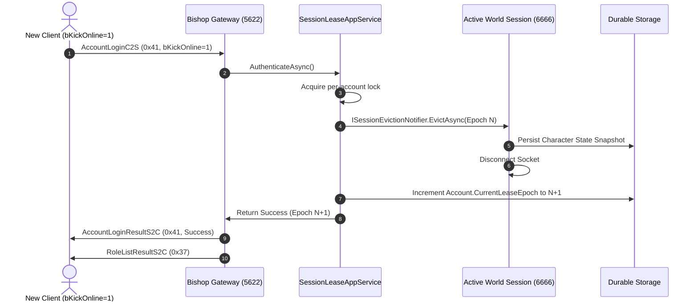

# Contract 02: Monotonic Session Lease-Epoch Fencing Contracts

**Feature**: [spec.md](../spec.md) | **Data Model**: [data-model.md](../data-model.md)  
**Standard**: [docs/data-architecture-standard.md](../../../docs/data-architecture-standard.md)  

---

## 1. Monotonic Fencing Epoch Lifecycle

Every player session is strictly bounded by an authoritative, monotonically increasing 64-bit integer `LeaseEpoch` anchored on the `Account` entity in durable storage:



---

## 2. Invariant & Fencing Rules

1. **Epoch Monotonicity**: `LeaseEpoch` strictly increases ($E_{new} > E_{old}$) upon every forced login, clean logout, or disconnect eviction. It never decrements.
2. **Stale Ticket Invalidation**: A world handoff ticket issued under epoch $E$ becomes immediately invalid if the account's epoch advances to $E+1$ before the ticket is redeemed on the world server.
3. **Evict-Before-Persist Guarantee**: Superseded sessions are disconnected and their state committed to durable storage *before* a new session is allowed to spawn the character into the active world.
4. **Ticket TTL Expiration**: Handoff tickets expire after 30 seconds (`DefaultHandoffTicketTtlSeconds = 30`). Expired tickets are rejected upon presentation (`RedeemHandoffTicketResult.TicketExpired`).
5. **Dual-Login Race Elimination**: Requests targeting the same `AccountId` are serialized using an asynchronous keyed lock (`SemaphoreSlim`). Simultaneous requests are evaluated in FIFO order, guaranteeing that exactly one session holds the valid lease epoch.

---

## 3. Application Port Contracts

```csharp
public interface ISessionLeaseAppService
{
    Task<AuthenticateAccountResultDto> AuthenticateAsync(AuthenticateAccountInput input, CancellationToken ct = default);
    Task<WorldHandoffTicketDto> SelectCharacterAsync(SelectCharacterInput input, CancellationToken ct = default);
    Task<RedeemHandoffTicketResultDto> RedeemHandoffTicketAsync(RedeemHandoffTicketInput input, CancellationToken ct = default);
    Task ReleaseSessionLeaseAsync(ReleaseSessionLeaseInput input, CancellationToken ct = default);
    Task CompleteLogoutOrEvictAsync(Guid accountId, long leaseEpoch, UpdateCharacterWorldSnapshotDto? snapshot, CancellationToken ct = default);
}

public interface ISessionEvictionNotifier
{
    Task NotifyEvictionAsync(Guid accountId, long supersededEpoch, CancellationToken ct = default);
}
```
