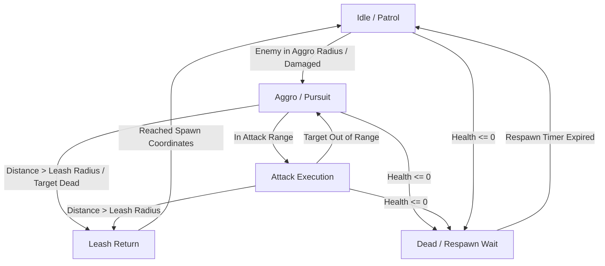

# Research & Technical Rationale: Core Monster AI, Death, Progression & Revival

**Feature Branch**: `010-core-monster-ai-and-progression`  
**Date**: 2026-11-11  

---

## 1. Ground-Truth Source Analysis

The AI state machine, experience progression, attribute allocation, and revival flows are directly derived from Kingsoft C++ sources:
- `Sources/Core/Src/KNpc.cpp` & `KNpcSet.cpp`: Autonomous creature state machine, aggro evaluation, pursuit navigation, leash return, and death broadcasts.
- `Sources/Core/Src/KPlayer.cpp`: Experience accrual, level threshold checks, attribute/skill point distribution, and revival logic.
- `settings/player/level_exp.txt`: Level progression experience requirements from Level 1 to 200.
- `settings/player/level_add.txt` & `newplayerini00..09.ini`: Class-based health, mana, stamina growth coefficients and base attribute increments.
- `Sources/Core/Src/KProtocol.h`: Binary wire packets `c2s_playeraddbaseattribute` (`0x57`), `c2s_playerapplyaddskillpoint` (`0x58`), `c2s_playerrevive` (`0x74`), `s2c_npcdeath` (`0x57`), `s2c_npcrevive` (`0x89`), `s2c_playerattribute` (`0x5D`), `s2c_playerskilllevel` (`0x5E`), `s2c_playerexp` (`0x5C`), and `s2c_playerlevelup` (`0x5B`).

---

## 2. 18-Hz Monster AI State Machine

Monsters operate under a deterministic state machine stepped synchronously on Phase 200 (`ZoneTickPhase.MonsterAi = 200`):

### 2.1 State Mechanics
- **Idle / Patrol**: When no hostile target is detected, the monster remains near its spawn anchor. Every few seconds, it selects a random point within `PatrolRadiusMps` and walks toward it.
- **Aggro / Pursuit**: Triggered when a hostile player enters `VisionRadiusMps` or damages the monster. The monster turns toward the target, closing distance at its movement speed.
- **Attack**: Triggered when the distance to the target is $\le \text{AttackRangeMps}$ and attack cooldown frames have elapsed. Executes the monster's assigned attack skill.
- **Leash Return**: Triggered when the monster is pulled beyond `MaxLeashRadiusMps` (typically 1.5x to 2x aggro radius) from its spawn anchor. The monster drops all aggro, becomes non-targetable, and returns directly to its spawn point, resetting vitals upon arrival.
- **Dead / Respawn Wait**: Upon reaching zero health, the monster broadcasts `0x57` (`s2c_npcdeath`), clears from the active region grid, and waits for `RespawnFrames` before respawning at full health.

---

## 3. Experience Progression & Level-Up Mathematics

### 3.1 Experience Accumulation
Monsters award a fixed base experience scaled by monster level. When the killer receives experience:
1. `CurrentExp` increases by the awarded amount.
2. If `CurrentExp >= MaxExpForLevel[CurrentLevel]`:
   - `CurrentExp -= MaxExpForLevel[CurrentLevel]`
   - `CurrentLevel += 1`
   - `UnallocatedAttributePoints += 5`
   - `UnallocatedSkillPoints += 1`
   - Maximum health, mana, and stamina expand based on class growth constants.
   - S2C packets `0x5B` (`s2c_playerlevelup`) and `0x5C` (`s2c_playerexp`) are dispatched.
3. If surplus experience exceeds the subsequent level threshold, the loop repeats iteratively until all level-ups are resolved.

### 3.2 Derived Attribute Mathematics
Allocating points into base attributes modifies combat statistics:
- **Strength (`0`)**: Increases melee physical damage.
- **Dexterity (`1`)**: Increases Attack Rating ($AR$) and Defense/Evasion Rating ($DR$).
- **Vitality (`2`)**: Increases Maximum Life ($MaxLife$) by the class vitality coefficient (e.g., +4 HP per vitality point for Shaolin/Tianwang).
- **Energy (`3`)**: Increases Maximum Mana ($MaxMana$) by the class energy coefficient (e.g., +4 Mana per energy point for Wudang).

---

## 4. Player Death & Sanctuary Revival Mechanics

- When a player falls to 0 HP:
  1. The player enters dead posture (`IsDead = true`).
  2. All monsters targeting the deceased player immediately drop aggro and return to idle/patrol.
  3. `s2c_npcdeath` (`0x57`) is broadcast to the 3x3 region AOI.
- When the player submits `c2s_playerrevive` (`0x74` with `ReviveType = 0` for town revival):
  1. Current health, mana, and stamina are restored to full maximum values.
  2. Posture is reset to peaceful mode (`FightMode = 0`).
  3. The player is repositioned to their bound revival coordinates (`RevivalMapId`, `RevivalPointId`).
  4. `s2c_npcrevive` (`0x89`) and spatial position sync packets are emitted.
